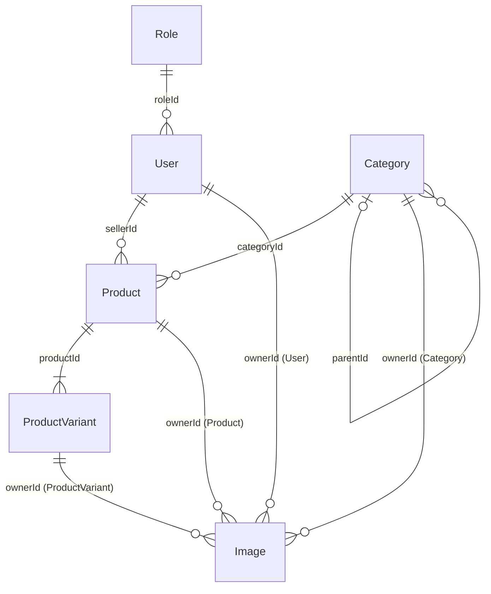

# Estructuración del prompt de ampliación del backend

Este documento explica **qué** se aplica en [PROMPT.md](PROMPT.md) y **dónde** queda cada cosa en `secondhand-api/`. Sirve para revisar el resultado de la implementación o para defenderlo en clase.

---

## 1. Visión general

| | Antes | Después |
|---|---|---|
| Colecciones | 1 (`products`) | 6 (`roles`, `users`, `categories`, `products`, `productVariants`, `images`) |
| Vendedor | Texto libre (`seller: "Juan"`) | Usuario real (`sellerId` → `users`) |
| Categoría | Enum fijo repetido en 3 sitios | Colección con árbol (`parentId`) y atributos de variante |
| Fotos | Array de URLs dentro del producto | Colección `images` común a todos los modelos |
| Precio y stock | En el producto | Precio base en el producto; precio, stock y estado por variante |
| CRUD por HTTP | Productos | **Solo productos** (el resto: modelo + seed) |

Lo que **no** cambia: la arquitectura por capas, el sistema de errores (`AppError`), la validación con Zod, los helpers de respuesta, el soft delete de productos y los endpoints existentes (cambia lo que devuelven, no las rutas).

---

## 2. Ficheros afectados

```
secondhand-api/
├── .env.example                      🆕  PORT, MONGODB_URI, CORS_ORIGIN, SEED_DEFAULT_PASSWORD
├── package.json                      ✏️  + bcryptjs
├── postman.md                        ✏️  nuevas formas de petición/respuesta de productos
├── README.md                         ✏️  modelo de datos, relaciones, seed, variables de entorno
└── src/
    ├── server.js                     ✏️  usa config/env.js; 404 JSON tras las rutas
    ├── seed.js                       ✏️  6 colecciones en orden de dependencias
    ├── config/
    │   ├── env.js                    🆕  lectura y validación (Zod) del entorno
    │   └── db.js                     ✏️  usa env.MONGODB_URI
    ├── models/
    │   ├── role.model.js             🆕
    │   ├── user.model.js             🆕
    │   ├── category.model.js         🆕
    │   ├── product.model.js          ✏️  sellerId, categoryId, basePrice, virtuals
    │   ├── productVariant.model.js   🆕
    │   └── image.model.js            🆕  polimórfica (refPath)
    ├── repositories/
    │   └── product.repository.js     ✏️  populate de category, seller, images y variants
    ├── services/
    │   └── product.service.js        ✏️  reglas de negocio (sección 5)
    ├── validators/
    │   └── product.validator.js      ✏️  sellerId, categoryId, basePrice
    ├── constants/
    │   └── permissions.js            🆕  catálogo de códigos de permiso
    └── utils/
        ├── slugify.js                ✏️  + uniqueSlug(Model, base)
        └── errorHandler.js           ✏️  + E11000 → 409, CastError → 422
```

🆕 nuevo · ✏️ modificado. No se crean `routes`, `controllers` ni `services` para roles, users, categories, variantes ni imágenes.

---

## 3. Cada instrucción y dónde se aplica

### 3.1 Buenas prácticas obligatorias

| Instrucción | Dónde | Cómo |
|---|---|---|
| `is_active` | Los 6 `*.model.js` | `isActive: { type: Boolean, default: true }` |
| `status` | Los 6 `*.model.js` | Enum propio de cada entidad (tabla 4.2) |
| `deleted_at` | Los 6 `*.model.js` + `product.service.js` | `deletedAt: { type: Date, default: null }`; el service lo rellena al borrar y propaga la cascada |
| `created_at` / `updated_at` | Los 6 `*.model.js` | `{ timestamps: true }` en el schema |
| `slug` | Modelos + `utils/slugify.js` | Productos: `slugify` + 409 si se repite. Users, variantes e imágenes: `uniqueSlug` con sufijo `-2`, `-3`… |
| Basarse en la DB existente | Sección 1 de `PROMPT.md` | No hay `.sql`: la base es el diseño MongoDB de 6 colecciones |
| No crear CRUD del resto | `routes/` | Solo existe `product.routes.js` |
| Crear modelos | `models/` | `Role`, `User`, `Image` + `Category` y `ProductVariant` (necesarios para las relaciones) |
| Seed | `src/seed.js` | roles → users → categories → products → productVariants → images |

### 3.2 Relaciones

| Instrucción | Dónde | Cómo |
|---|---|---|
| One-to-Many | Modelos con `ref` + `product.repository.js` | `roleId`, `sellerId`, `categoryId`, `parentId` y `productId` son ObjectId con `ref`; se leen con `populate()` |
| One-to-Many inversa | `product.model.js` | Virtuals `variants` e `images` (`localField: '_id'`, `foreignField`) |
| Polimórfica | `image.model.js` | `ownerId` con `refPath: 'ownerType'`; una sola colección para todos los modelos |
| Many-to-Many | — | No hay ninguna en esta fase. La regla para el futuro: colección intermedia (`favorites { userId, productId }` con índice único compuesto) |

### 3.3 Validaciones y manejo de errores

| Instrucción | Dónde | Cómo |
|---|---|---|
| Validación de entrada | `validators/product.validator.js` + `middlewares/validate.js` | Zod sobre `params`, `query` y `body` → `ValidationError` (422) |
| Middleware global de errores | `utils/errorHandler.js` | `AppError` → su código; E11000 → 409; `CastError` → 422; resto → 500 |
| Existencia antes de operar | `services/product.service.js` | Comprueba `categoryId`, `sellerId` y el producto antes de escribir → 404 o 422 |
| Respuestas consistentes | `utils/response.js` + `errorHandler.js` | `{ success, data }` y `{ success: false, message }` |
| try/catch y async/await | `utils/catchAsync.js` | Los controllers no llevan try/catch; los errores llegan al `errorHandler` |
| Mensajes claros | Validadores y services | En español, nombrando el campo ("La categoría no existe") |

### 3.4 Estándares API

| Código | Dónde se genera |
|---|---|
| `200` | `sendSuccess()` en el controller (GET, PATCH) |
| `201` | `sendCreated()` en `create` |
| `204` | `sendNoContent()` en `softDelete` |
| `404` | `NotFoundError` en el service, o el manejador de ruta inexistente en `server.js` |
| `409` | `ConflictError` (slug de producto) o E11000 en el `errorHandler` |
| `422` | `ValidationError` (Zod), referencia inválida en el service o `CastError` |
| PATCH | `product.routes.js`: no hay rutas PUT |

### 3.5 Configuración

| Instrucción | Dónde | Cómo |
|---|---|---|
| CORS abierto en desarrollo | `server.js` | `cors()`; en producción, `cors({ origin: env.CORS_ORIGIN })` |
| `.env` | `.env` + `.env.example` | Variables documentadas; `.env` sigue en `.gitignore` |
| Configuración centralizada | `config/env.js` | Valida el entorno al arrancar y falla rápido si falta algo |
| async/await | Toda la app | Repositorios, services, seed, `connectDB` |
| slugify | `utils/slugify.js` | `slugify()` (sin acentos ni símbolos) + `uniqueSlug()` |

---

## 4. Modelo de datos

### 4.1 Relaciones

Diagrama con las relaciones y las referencias. Los atributos completos de cada modelo están en la sección 1 de [PROMPT.md](PROMPT.md).



| Referencia | Desde | Hacia | Cardinalidad |
|---|---|---|---|
| `roleId` | `User` | `Role` | Un rol, muchos usuarios |
| `sellerId` | `Product` | `User` | Un usuario vende muchos productos |
| `categoryId` | `Product` | `Category` | Una categoría agrupa muchos productos |
| `parentId` | `Category` | `Category` | Una categoría tiene 0 o 1 padre y muchas subcategorías |
| `productId` | `ProductVariant` | `Product` | Un producto tiene **1 o más** variantes |
| `ownerType` + `ownerId` | `Image` | `User` \| `Category` \| `Product` \| `ProductVariant` | Un propietario tiene muchas imágenes (polimórfica, `refPath`) |
| `uploadedBy`, `deletedBy` | `Image` / todas | `User` | Auditoría |

### 4.2 `isActive`, `status` y `deletedAt` en cada entidad

Son tres ejes distintos: **visibilidad**, **estado de negocio** y **existencia**.

| Entidad | `isActive: false` significa | `status` (negocio) | `deletedAt` |
|---|---|---|---|
| `roles` | No se puede asignar | `active` · `deprecated` | Rol eliminado (solo si `isSystem: false`) |
| `users` | Cuenta bloqueada | `pending` · `verified` · `suspended` | Cuenta eliminada |
| `categories` | Oculta en la tienda | `draft` · `published` | Categoría eliminada |
| `products` | Oculto de la tienda, sin borrar | `disponible` · `reservado` · `vendido` (calculado) | En la papelera |
| `productVariants` | Opción no seleccionable | `disponible` · `reservado` · `vendido` | Variante eliminada (cascada desde el producto) |
| `images` | No se muestra | `pending` · `ready` · `failed` | Imagen eliminada (cascada desde su propietario) |

### 4.3 Decisiones de modelado

- **Referenciar** lo que cambia por su cuenta (usuario, categoría) y **embeber** lo pequeño que siempre se lee junto (opciones de variante, atributos de categoría).
- **Imágenes polimórficas:** una sola colección en lugar de una por modelo; se filtra por `ownerType` + `ownerId`.
- **Variante por defecto siempre presente:** el stock, el precio final y el estado viven siempre en una variante, así que reservas y pagos futuros apuntan a `variantId` sin casos especiales.
- **Campos desnormalizados** (`products.status` y `variantsCount`): los listados no tienen que consultar variantes. El service los mantiene al día.
- **Permisos como códigos dentro del rol:** comprobar un permiso no requiere otra consulta.

---

## 5. Recorrido de una petición: `POST /api/products`

```
1. routes/product.routes.js      validate({ body: createProductSchema })
                                 → forma y tipos (Zod)                     ✗ 422
2. controllers/product.controller.js   catchAsync → productService.create(body)
3. services/product.service.js   ¿existe y está activa la categoría?       ✗ 422
                                 ¿existe y está activo el vendedor?        ✗ 422
                                 slug = slugify(title); ¿libre?            ✗ 409
                                 crea el producto + su variante por defecto
4. repositories/...              Product.create / ProductVariant.create
5. models/...                    validación de schema e índices únicos     ✗ 409 (E11000)
6. controller                    sendCreated(res, product)                 ✓ 201
   (cualquier error)             → utils/errorHandler.js → { success: false, message }
```

---

## 6. El seed

| Paso | Colección | Por qué en este orden | Contenido |
|---|---|---|---|
| 1 | `roles` | No depende de nada | admin, moderator, seller, user (`isSystem`) |
| 2 | `users` | Necesita `roleId` | 1 admin, 3 vendedores, 1 usuario; contraseña de `SEED_DEFAULT_PASSWORD` hasheada con bcryptjs |
| 3 | `categories` | Las subcategorías necesitan `parentId` | 8 raíz + al menos 3 subcategorías, con `attributes` |
| 4 | `products` | Necesita `sellerId` y `categoryId` | 14 productos: 8 activos, 3 inactivos, 3 en papelera |
| 5 | `productVariants` | Necesita `productId` | 1 por defecto por producto + tallas y capacidades en 2 productos |
| 6 | `images` | Necesita el `ownerId` de los anteriores | Portadas y galerías de producto, avatares de usuario |

Se usa `Model.create()` en bucle (y no `insertMany`) para que se ejecuten los hooks que generan los slugs.

---

## 7. Adaptaciones respecto a las instrucciones originales

Las instrucciones de buenas prácticas venían de otro proyecto (Airbnb, en SQL). Así se han adaptado a Revishop:

| Instrucción original | Adaptación | Motivo |
|---|---|---|
| "Basarse en la DB existente en `experiences.sql`" | El diseño MongoDB de 6 colecciones | Revishop usa MongoDB; no hay SQL |
| `is_active`, `deleted_at`, `created_at`, `updated_at` | `isActive`, `deletedAt`, `createdAt`, `updatedAt` | Es la convención que ya usan la API y el front; cambiarla rompería los dos. Equivalencia documentada en la sección 2 del prompt |
| "Crea solamente los modelos de Role, User y Image" | + `Category` y `ProductVariant`, y se modifica `Product` | Sin ellos no existen las relaciones `categoryId` ni las variantes |
| Seed de "locations, hosts, experiences, departures" | Seed de categories, users (vendedores), products y productVariants | Son las entidades equivalentes de Revishop. No hay colección de ubicaciones: `location` es un campo de texto |
| Many-to-Many con tablas intermedias | Regla documentada, sin N:M en esta fase | `favorites` se dejó fuera; las imágenes son 1:N polimórfica |
| 422 en validación | Se mantiene, y se añade 409 para duplicados | Distingue "datos mal formados" de "ya existe" |

---

## 8. Cambios de contrato para el front (fase posterior)

| Antes | Después |
|---|---|
| `price: number` | `basePrice: number` (+ `price` por variante) |
| `category: "electronica"` | `category: { _id, name, slug }` (y en escritura, `categoryId`) |
| `seller: "Juan"` | `seller: { _id, name, slug }` (y en escritura, `sellerId`) |
| `images: string[]` | `images: [{ url, alt, kind, isPrimary, order, width, height }]` |
| `status` editable siempre | Editable solo si el producto tiene una única variante |
| — | `variants: [...]` en el detalle y `variantsCount` en los listados |

El front Angular (`ProductsService`, `Product` model, formulario y cards) se adaptará cuando se implemente este prompt.
