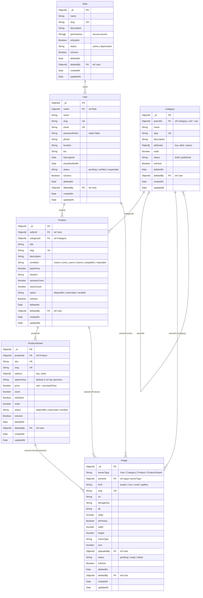

# Prompt: Ampliar el modelo de datos de `secondhand-api` (Revishop)

## 0. Rol y forma de trabajar

Actúa como **Senior Backend Engineer especializado en Node.js, Express y MongoDB (Mongoose)**. Vas a ampliar el modelo de datos de la API de **Revishop**, un marketplace de segunda mano tipo Wallapop.

- Trabajas **solo en `secondhand-api/`**. No toques `secondhand-front/`: si un cambio rompe el contrato que consume el front, documéntalo en el resumen final como "cambios de contrato para el front".
- Mantén la arquitectura actual: `routes → controllers → services → repositories → models`, `utils/` (AppError, catchAsync, response, errorHandler, slugify), `middlewares/validate.js` (Zod) y ES Modules (`import`/`export`).
- **Audita primero.** Lee `src/models/`, `src/services/`, `src/repositories/`, `src/validators/`, `src/middlewares/`, `src/utils/`, `src/routes/`, `src/seed.js`, `postman.md` y `README.md`. No asumas nada.
- Trabaja **por fases** (sección 9). Al terminar cada fase arranca la API (`npm run dev`), ejecuta `npm run seed` y prueba con peticiones reales. No avances si algo falla.
- Al final entrega un resumen corto: qué cambió, decisiones tomadas, cambios de contrato para el front y qué quedó pendiente.

---

## 1. Base de datos de referencia

El proyecto usa **MongoDB**: no hay ningún fichero SQL. La base es este diseño de **6 colecciones**:

| Modelo (`mongoose.model`) | Colección | Fichero |
|---|---|---|
| `Role` | `roles` | `src/models/role.model.js` |
| `User` | `users` | `src/models/user.model.js` |
| `Category` (Catálogo) | `categories` | `src/models/category.model.js` |
| `Product` | `products` | `src/models/product.model.js` |
| `ProductVariant` | `productvariants` | `src/models/productVariant.model.js` |
| `Image` | `images` | `src/models/image.model.js` |

**Convenciones de nombres:**
- **Modelos:** en singular y PascalCase.
- **Atributos:** en camelCase.
- **Referencias:** `<entidad>Id` con `ref: '<Modelo>'`.
- **Excepción, `Image.ownerId`:** usa `refPath: 'ownerType'`. Por eso `ownerType` guarda el **nombre exacto del modelo** (`'User'`, `'Category'`, `'Product'`, `'ProductVariant'`).

`deletedBy → User` está en todas las entidades, pero el diagrama no dibuja esas líneas para no llenarlo de cruces.

Fuera de esta fase: `favorites`, `conversations`, `messages`, `reservations`, `reviews`, `payments`, `shipments`, `addresses`, `sessions`.

---

## 2. Buenas prácticas obligatorias

**Todas** las entidades incluyen estos campos:

| Instrucción | Campo en el código | Tipo y valor por defecto |
|---|---|---|
| `is_active`: activar/desactivar | `isActive` | Boolean, `true` |
| `status`: estado de negocio | `status` | enum propio de cada entidad (sección 3) |
| `deleted_at`: soft delete | `deletedAt` | Date \| null, `null` |
| `created_at`: fecha de creación | `createdAt` | Date (timestamps de Mongoose) |
| `updated_at`: fecha de actualización | `updatedAt` | Date (timestamps de Mongoose) |
| `slug`: identificador legible | `slug` | String, **único**, generado con `slugify` |

**Convención de nombres:** se usa **camelCase** (`isActive`, `deletedAt`, `createdAt`, `updatedAt`), porque es lo que ya usan la API y el front Angular. Si se quisiera snake_case en la base de datos, bastaría con `timestamps: { createdAt: 'created_at', updatedAt: 'updated_at' }` y renombrar los campos. **No lo hagas en esta fase.**

Reglas de soft delete:
- `DELETE` nunca borra el documento: pone `deletedAt = new Date()` e `isActive = false`, y guarda `deletedBy` si se conoce.
- Un documento con `deletedAt != null` nunca puede estar `isActive: true`.
- Todas las lecturas públicas excluyen `deletedAt != null`.

---

## 3. Colecciones y campos

Además de los comunes (`isActive`, `status`, `deletedAt`, `deletedBy`, `slug`, timestamps), cada colección lleva estos campos:

### 3.1 `roles`
| Campo | Tipo | Notas |
|---|---|---|
| `name` | String, requerido | "Administrador" |
| `slug` | String, único | `admin`, `moderator`, `seller`, `user` |
| `description` | String | |
| `permissions` | [String], requerido | Códigos `recurso:acción` validados contra una constante `PERMISSIONS` (p. ej. `products:read`, `products:write`, `products:delete`, `products:restore`, `users:manage`, `categories:manage`, `roles:manage`) |
| `isSystem` | Boolean, por defecto `false` | Los roles base no se pueden borrar ni renombrar |
| `status` | `active` \| `deprecated` | `deprecated` = no se asigna a usuarios nuevos |

### 3.2 `users`
| Campo | Tipo | Notas |
|---|---|---|
| `name` | String, requerido | Entre 2 y 60 caracteres |
| `slug` | String, único | Desde `name` (perfil público `/users/:slug`); si se repite, sufijo `-2`, `-3`… |
| `email` | String, requerido, único | En minúsculas, con `trim` |
| `passwordHash` | String, requerido | `select: false`; nunca sale en las respuestas |
| `roleId` | ObjectId → `roles`, requerido | |
| `phone` | String | |
| `location` | String | Ciudad por defecto al publicar |
| `bio` | String | Máximo 300 caracteres |
| `lastLoginAt` | Date | |
| `emailVerifiedAt` | Date \| null | |
| `status` | `pending` \| `verified` \| `suspended` | Por defecto `pending` |

El avatar es una imagen con `ownerType: 'user'` y `kind: 'avatar'`.

### 3.3 `categories` (Catálogo)
| Campo | Tipo | Notas |
|---|---|---|
| `name` | String, requerido | |
| `slug` | String, único | Mismos valores que el enum actual (`electronica`, `ropa`…) |
| `description` | String | |
| `parentId` | ObjectId → `categories` \| null | `null` = categoría raíz |
| `attributes` | [{ `key`, `label`, `values: [String]` }] | Opciones válidas de variante (talla, color, capacidad); las subcategorías las heredan si no definen las suyas |
| `order` | Number, por defecto 0 | |
| `status` | `draft` \| `published` | Solo las `published` se usan en la tienda |

### 3.4 `products` (modificar el modelo existente)
| Campo | Tipo | Cambio |
|---|---|---|
| `title`, `slug`, `description`, `condition`, `location` | igual | — |
| `sellerId` | ObjectId → `users`, requerido | **Sustituye** a `seller: String` |
| `categoryId` | ObjectId → `categories`, requerido | **Sustituye** al enum `category` |
| `basePrice` | Number ≥ 0, requerido | **Renombra** `price` |
| `status` | `disponible` \| `reservado` \| `vendido` | Pasa a **calcularse** desde las variantes (sección 5) |
| `variantsCount` | Number, por defecto 1 | Desnormalizado |
| `viewsCount` | Number, por defecto 0 | |
| `images` (array de URLs) | — | **Se elimina**: las fotos pasan a la colección `images` |

### 3.5 `productVariants`
| Campo | Tipo | Notas |
|---|---|---|
| `productId` | ObjectId → `products`, requerido | |
| `sku` | String, requerido, único | p. ej. `CHAQ-NF-NEGRO-M` |
| `slug` | String, único | `slug-del-producto` + opciones (`chaqueta-north-face-negro-m`); la variante por defecto usa `slug-del-producto-default` |
| `options` | [{ `key`, `value` }] | Vacío en la variante por defecto; validado contra `category.attributes` |
| `optionsKey` | String, requerido | Opciones normalizadas y ordenadas (`color:negro\|talla:m`); único junto con `productId` |
| `price` | Number ≥ 0 \| null | `null` = usa `basePrice` |
| `stock` | Number ≥ 0, por defecto 1 | |
| `status` | `disponible` \| `reservado` \| `vendido` | |
| `isDefault` | Boolean | Exactamente una por producto |
| `order` | Number | |

### 3.6 `images` (polimórfica)
| Campo | Tipo | Notas |
|---|---|---|
| `ownerType` | `User` \| `Category` \| `Product` \| `ProductVariant`, requerido | Nombre exacto del modelo (lo exige `refPath`) |
| `ownerId` | ObjectId, requerido | `refPath: 'ownerType'` |
| `kind` | `avatar` \| `icon` \| `cover` \| `gallery`, requerido | |
| `slug` | String, único | Desde `alt` o el nombre del propietario + índice (`iphone-13-pro-1`) |
| `url` | String, requerido | http/https |
| `storageKey` | String | ID en el proveedor (Cloudinary/S3) |
| `alt` | String | Accesibilidad |
| `order` | Number | |
| `isPrimary` | Boolean | Una por propietario (portada o avatar actual) |
| `width`, `height` | Number | |
| `mimeType`, `size` | String, Number | jpg/png/webp, máximo 5 MB |
| `uploadedBy` | ObjectId → `users` | |
| `status` | `pending` \| `ready` \| `failed` | Procesado de la subida; las del seed, `ready` |

### 3.7 Índices
- **Únicos:** `roles.slug`, `users.email`, `users.slug`, `categories.slug`, `products.slug`, `productVariants.sku`, `productVariants.slug`, `{ productId, optionsKey }` e `images.slug`.
- **`products`:** `{ deletedAt: 1, isActive: 1, createdAt: -1 }`, `{ categoryId: 1 }`, `{ sellerId: 1 }` y de texto `{ title: 'text', description: 'text' }`.
- **`productVariants`:** `{ productId: 1, order: 1 }`.
- **`images`:** `{ ownerType: 1, ownerId: 1, order: 1 }` y `{ ownerType: 1, ownerId: 1, isPrimary: 1 }`.
- **`categories`:** `{ parentId: 1, order: 1 }`.

---

## 4. Relaciones

### One-to-Many (con referencias `ObjectId` + `ref`)
| Relación | Campo | Lectura |
|---|---|---|
| Role 1 → N User | `users.roleId` | `populate('role')` (virtual) |
| User 1 → N Product | `products.sellerId` | `populate('seller', 'name slug location')` |
| Category 1 → N Product | `products.categoryId` | `populate('category', 'name slug')` |
| Category 1 → N Category | `categories.parentId` | Subcategorías |
| Product 1 → N ProductVariant | `productVariants.productId` | **Virtual populate** `product.variants` |
| (User \| Category \| Product \| Variant) 1 → N Image | `images.ownerType` + `ownerId` | **Virtual populate** con `match: { ownerType }` |

### Many-to-Many
- En esta fase **no hay ninguna** relación N:M: las imágenes son una relación polimórfica 1:N, y `favorites` está fuera de alcance.
- La regla para el futuro: toda N:M se modela con una **colección intermedia propia** (p. ej. `favorites { userId, productId, createdAt }` con índice único compuesto), **nunca** con arrays de ObjectId que crecen sin límite.

---

## 5. Reglas de negocio

- **Variante por defecto obligatoria:** al crear un producto se crea automáticamente su variante por defecto (`isDefault: true`, `options: []`, `stock: 1`, `price: null`). No se puede borrar la última variante activa.
- **`products.status` calculado:**
  - todas las variantes vendidas → `vendido`;
  - si no, ninguna disponible y alguna reservada → `reservado`;
  - en cualquier otro caso → `disponible`.

  Se recalcula en el service cada vez que cambia una variante.
- **PATCH del `status` de un producto:** si tiene una sola variante, actualiza la variante y el producto; si tiene varias, responde **422** ("el estado se gestiona por variante").
- **Cascada de soft delete:**
  - borrar un producto marca `deletedAt` en sus variantes y en sus imágenes;
  - `restore` revierte las tres cosas.
- **Slugs:**
  - `products` mantiene su política actual: **409** si el slug ya existe;
  - `users`, `productVariants` e `images` generan un slug único con sufijo incremental mediante un helper `uniqueSlug(Model, base)` en `utils/slugify.js`.
- **Existencia antes de operar:** antes de crear o editar un producto, comprueba que `categoryId` y `sellerId` existen, están activos y no borrados (si no, 422 con el campo en el mensaje). Comprueba también que las opciones de las variantes están en `category.attributes`.

---

## 6. Alcance: modelos, CRUD y seed

- **Modelos nuevos:** `Role`, `User`, `Image`, `Category` y `ProductVariant`, en `src/models/<entidad>.model.js`.
- **Modelo modificado:** `Product`.
- **No crees CRUD** (rutas, controladores ni servicios HTTP) de las colecciones nuevas. Solo existe el CRUD de **productos**, que ya está hecho y se adapta a los campos nuevos:
  - `POST /products` y `PATCH /products/:id` aceptan `sellerId`, `categoryId` y `basePrice`, validados con Zod (ObjectId de 24 hex). `price`, `category` y `seller` dejan de aceptarse.
  - `GET /products`, `GET /products/actives`, `GET /products/inactives` y `GET /products/trash` devuelven cada producto con `category { name, slug }`, `seller { name, slug }`, la imagen principal y `variantsCount`.
  - `GET /products/slug/:slug` y `GET /products/:id` devuelven además todas las imágenes y todas las variantes activas.
- **Seed (`src/seed.js`)** de `roles`, `users`, `categories`, `products`, `productVariants` e `images`:
  - Vacía las 6 colecciones e inserta **en orden de dependencias**: roles → users → categories → products → productVariants → images.
  - Usa `Model.create` en bucle para que se ejecuten los hooks (slug).
  - **Roles:** `admin`, `moderator`, `seller` y `user` (`isSystem: true`) con sus permisos.
  - **Users:** 1 admin, 3 vendedores y 1 usuario normal, con avatar. La contraseña se lee de `SEED_DEFAULT_PASSWORD` en `.env` (documentada en `.env.example`) y se hashea con `bcryptjs`. Nunca se guarda una contraseña en claro en el repositorio.
  - **Categories:** las 8 raíz actuales con sus `attributes` y al menos 3 subcategorías (p. ej. Electrónica → Móviles, Ropa → Chaquetas).
  - **Products:** los 14 actuales (8 activos, 3 inactivos y 3 en papelera), asignados a vendedores y categorías.
  - **ProductVariants:** una por defecto por producto, más variantes reales en al menos 2 productos (la chaqueta en tallas S/M/L, el iPhone en 128/256 GB) con precios y estados distintos.
  - **Images:** las URLs verificadas que ya usa el seed (picsum), como `cover`/`gallery` de producto, y avatares de usuario.
  - Al terminar, muestra un resumen por colección y, en productos, por estado (activos / inactivos / papelera).

---

## 7. Validaciones y manejo de errores

- **Validación de entrada:** Zod en `validators/` y el middleware `validate({ params, query, body })` que ya existe. Los errores de validación devuelven **422**.
- **Middleware global de errores:** el `errorHandler` existente. Añádele:
  - error de duplicado de Mongo (E11000) → **409**;
  - `CastError` de Mongoose → **422**;
  - ruta inexistente → **404 en JSON** (hoy devuelve el HTML de Express).
- **Validación de existencia** antes de cada operación (sección 5), con `NotFoundError` (404) para el recurso principal.
- **Respuestas consistentes:**
  - éxito `{ success: true, data }` (helpers de `utils/response.js`);
  - error `{ success: false, message }`.
- **Async/await y try/catch:**
  - los controllers van envueltos en `catchAsync` (sin try/catch propio);
  - `try/catch` solo donde haga falta transformar un error, como en el seed y en `connectDB`.
- **Mensajes de error** claros, en español y que nombren el campo afectado.

---

## 8. Estándares API y configuración

| Código | Cuándo |
|---|---|
| `200 OK` | GET o PATCH con éxito |
| `201 Created` | POST con éxito |
| `204 No Content` | DELETE (soft delete) |
| `404 Not Found` | Recurso o ruta inexistente |
| `409 Conflict` | Slug o email duplicado |
| `422 Unprocessable Entity` | Error de validación o referencia inválida |

- **PATCH** para actualizaciones parciales; no se usa PUT.
- **CORS** abierto en desarrollo (`cors()`). En producción se limitará a `CORS_ORIGIN` del `.env`.
- **Variables de entorno** en `.env`, documentadas en `.env.example`: `PORT`, `MONGODB_URI`, `CORS_ORIGIN` y `SEED_DEFAULT_PASSWORD`.
- **Configuración centralizada** en `src/config/env.js`: lee y valida el entorno con Zod y lo exporta. Nadie más usa `process.env` directamente.
- **async/await** en toda la app.
- **slugify** en `utils/slugify.js` para todas las URLs legibles, más el helper `uniqueSlug`.

---

## 9. Fases

1. **Auditoría + configuración:** `config/env.js`, `.env.example`, `bcryptjs`, `uniqueSlug`, 404 JSON y mejoras del `errorHandler`.
2. **Modelos:** `Role`, `User`, `Category`, `Image` y `ProductVariant`, con índices y virtuals.
3. **Producto:** modificar el modelo, el repositorio (populate y virtuals), el service (reglas de la sección 5) y los validadores Zod.
4. **Seed** completo en orden de dependencias.
5. **Verificación y documentación:** probar todos los endpoints de productos y actualizar `postman.md` y `README.md` (modelo de datos, relaciones, seed y variables de entorno).

## 10. Criterios de aceptación

- [ ] Las 6 colecciones tienen `isActive`, `status`, `deletedAt`, `slug`, `createdAt` y `updatedAt`, y los índices de la sección 3.7.
- [ ] `npm run seed` termina sin errores y muestra el resumen por colección; volver a ejecutarlo da el mismo resultado.
- [ ] Ninguna respuesta contiene `passwordHash`.
- [ ] `GET /products/slug/:slug` devuelve producto con `category`, `seller`, imágenes y variantes.
- [ ] Crear un producto genera su variante por defecto; un `categoryId` o `sellerId` inexistente devuelve 422; un slug duplicado, 409.
- [ ] El soft delete de un producto se propaga a sus variantes e imágenes, y `restore` lo revierte.
- [ ] Una ruta inexistente devuelve 404 en JSON.
- [ ] No hay rutas CRUD de roles, users, categories, variantes ni imágenes.
- [ ] `postman.md` y `README.md` están actualizados, y el resumen final lista los cambios de contrato para el front (`price` → `basePrice`, `category` y `seller` pasan a objetos, `images` cambia de forma).

## 11. Objetivo final

Un **backend profesional tipo Wallapop**, escalable y mantenible, con un **dashboard administrativo API-ready**, preparado para integrar el frontend Angular en fases posteriores.
