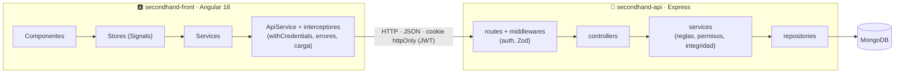
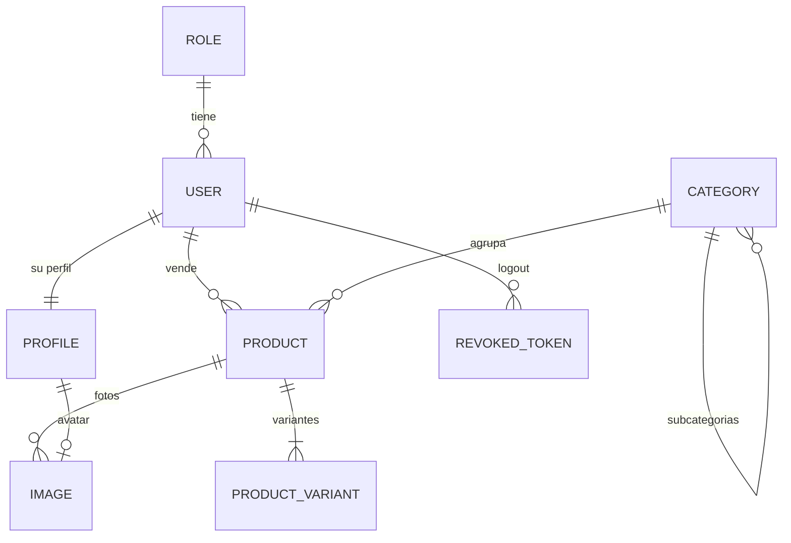

<div align="center">


# ♻️ Revishop

### Marketplace de segunda mano: cualquier usuario compra y vende, y cada objeto encuentra una segunda vida.

Proyecto de **2º DAW** formado por una **API REST** (Express + MongoDB) y una **SPA** (Angular 18) con tienda pública, sesión con JWT en cookie `httpOnly` y panel de administración.


<br/>


[Qué hace](#-qué-hace) · [Puesta en marcha](#-puesta-en-marcha) · [Arquitectura](#️-arquitectura) · [Modelo](#️-modelo-de-datos) · [API](#-api) · [Frontend](#️-frontend) · [Decisiones](#-decisiones-de-diseño) · [Hoja de ruta](#️-estado-y-hoja-de-ruta)

<table>
<tr>
<td align="center" width="50%"><a href="secondhand-api/README.md"><b>🔌 secondhand-api</b></a><br/><sub>Express · Mongoose · Zod · JWT · Swagger</sub></td>
<td align="center" width="50%"><a href="secondhand-front/README.md"><b>🅰️ secondhand-front</b></a><br/><sub>Angular 18 · Signals · Tailwind</sub></td>
</tr>
</table>

</div>

---

## ✨ Qué hace

<table>
<tr>
<td width="33%" valign="top">

### 🛍️ Tienda
- **Catálogo** con filtros (categoría y sus subcategorías, condición, estado y precio) y orden.
- **Ficha** con galería, nivel de conservación y **variantes** (talla, capacidad…) con su precio y estado.
- Errores del servidor **junto al campo** que los provoca.

</td>
<td width="33%" valign="top">

### 🔐 Tu cuenta
- **Iniciar y cerrar sesión** (el token queda revocado).
- **Publicar, editar y retirar** tus anuncios, con hasta 5 fotos.
- **Mi perfil**: foto, teléfono, ubicación y bio.
- Tus anuncios ocultos solo los ves tú.

</td>
<td width="33%" valign="top">

### 🛡️ Panel de admin
- **Resumen** con métricas reales del inventario.
- **Productos**, **categorías** (en árbol) y **usuarios** en pestañas Activos · Inactivos · Papelera.
- Cambios **optimistas** que vuelven atrás si la API falla.
- **Editor de variantes** con los atributos de la categoría.

</td>
</tr>
</table>

---

## 🚀 Puesta en marcha

> **Requisitos:** Node.js 18+ y MongoDB en local (o una URI de Atlas).

```bash
# 1 · API
cd secondhand-api
npm install
cp .env.example .env    # rellena MONGODB_URI, JWT_SECRET y SEED_DEFAULT_PASSWORD
npm run seed            # ⚠️ vacía la base y carga los datos de prueba
npm run dev             # http://localhost:3000

# 2 · Front (en otra terminal)
cd secondhand-front
npm install
npm start               # http://localhost:4200
```

| | URL |
|:-:|---|
| 🛍️ | **Tienda** · http://localhost:4200 |
| 🛡️ | **Panel** · http://localhost:4200/admin |
| 📖 | **Swagger** · http://localhost:3000/api/docs |

> [!TIP]
> El entorno se valida con Zod al arrancar: si falta algo obligatorio, la API no arranca y dice qué falta. Todas las variables están explicadas en el [README de la API](secondhand-api/README.md#️-variables-de-entorno).

### 👥 Usuarios de prueba

El seed crea **3 roles, 6 usuarios** con sus perfiles, **13 categorías** (una en borrador), **20 productos** (14 activos, 3 inactivos y 3 en la papelera), **27 variantes** y sus fotos. Todos los usuarios usan la contraseña de **`SEED_DEFAULT_PASSWORD`** (guardada con Argon2id).

| | Usuario | Email | Rol |
|:-:|---|---|---|
| 🛡️ | Admin Revishop | `admin@revishop.test` | admin |
| 🙋 | Lucía Martín | `lucia@revishop.test` | user |
| 🙋 | Juan Pérez | `juan@revishop.test` | user |
| 🙋 | Marta Gil | `marta@revishop.test` | user |
| 🙋 | Carlos Ruiz | `carlos@revishop.test` | user |
| ⛔ | Pablo Sanz | `pablo@revishop.test` | user · **suspendido** (no puede entrar ni vender) |

**Cómo entrar:**
- 🌐 **En la web:** botón **Iniciar sesión** (`/login`). El admin llega al panel; el resto, a la tienda. **Cerrar sesión** está en el menú de tu foto.
- 📖 **En Swagger:** *Try it out* en `POST /auth/login` con el email y la contraseña. La cookie de sesión se guarda y el resto de pruebas ya van con sesión (no hace falta **Authorize**).

---

## 🏗️ Arquitectura



| Proyecto | Flujo | Claves |
|---|---|---|
| **API** | `routes → validate → controllers → services → repositories → models` | Las reglas de negocio solo viven en los **services**; solo los **repositories** tocan Mongo |
| **Front** | `componente → store → service → ApiService → interceptores` | Ningún componente usa `HttpClient`; RxJS solo en los interceptores, el resto con `async/await` |

**Reglas que sigue el código:** `constants/` no importa nada del proyecto, `utils/` solo importa `constants/` y los archivos de dominio se llaman `<entidad>.<capa>`.

---

## 🗃️ Modelo de datos



| | |
|---|---|
| 👤 **Cuenta y perfil** | `users` es la cuenta (rol, email, contraseña, estado); `profiles` es lo que la persona cuenta de sí misma (teléfono, ubicación, bio y avatar), **1 a 1** y siempre con su usuario |
| 🏷️ **Categorías** | Árbol de dos niveles, con **borrador** y **atributos de variante** que heredan las subcategorías |
| 📦 **Productos** | Su `status` (disponible · reservado · vendido) se **calcula** a partir de sus variantes |
| 🖼️ **Imágenes** | **Polimórficas** (`ownerType` + `ownerId`): avatar, icono de categoría o fotos de producto y variante |
| 🚫 **`revoked_tokens`** | La blacklist del logout, con índice **TTL** que borra cada fila cuando el token habría caducado |
| 🗑️ **Soft delete** | Plugin de Mongoose en todas las colecciones: borrado **en cascada**, restauración **exacta** y `deletedBy` con quién lo borró |
| 🔗 **Integridad** | MongoDB no tiene claves foráneas, así que la garantizan **los services** (rol asignable, categoría que acepta productos, no borrar lo que tiene dependientes…) |

---

## 🔌 API

Base: `http://localhost:3000/api` · Documentación interactiva en **`/api/docs`**.

**Leyenda:** 🌐 público · 🔑 con sesión · 👤 su dueño o un admin · 🛡️ solo admin

| Recurso | Endpoints |
|---|---|
| 🔐 **Auth** | 🌐 `POST /auth/login` · 🔑 `GET /auth/me` · 🔑 `POST /auth/logout` |
| 👤 **Perfil** | 🔑 `GET /profile/me` · 🔑 `PATCH /profile/me` |
| 📦 **Productos** | 🌐 `GET /products` (solo activos) · 🌐 `/slug/:slug` · 🔑 `POST` · 👤 `PATCH /:id` · `/:id/status` · `/:id/active` · `DELETE /:id` · 🛡️ `/actives` · `/inactives` · `/trash` · `/:id` · `PATCH /:id/restore` |
| 🎨 **Variantes** | 🌐 `GET /products/:id/variants` · 👤 `POST /products/:id/variants` · `PATCH` · `DELETE /variants/:id` |
| 🏷️ **Categorías** | 🌐 `GET /categories` · 🛡️ el resto del CRUD |
| 🙋 **Usuarios** | 🛡️ CRUD completo · 🛡️ `GET /roles` · 🌐 `GET /sellers` |

<details>
<summary><b>🔐 Cómo funciona la sesión</b></summary>

<br/>

1. `POST /api/auth/login` con `{ email, password }` guarda el JWT en la cookie **`revishop_session`** y devuelve solo `{ user }`.
2. El navegador envía la cookie solo en cada petición a `/api`. JavaScript **no puede leerla**.
3. `POST /api/auth/logout` apunta el token en la blacklist y borra la cookie: desde ese momento ese token da `401`, aunque no haya caducado.

| Atributo de la cookie | Para qué |
|---|---|
| `HttpOnly` | Un script en la página (XSS) no puede robar el token |
| `SameSite=Strict` | No viaja en peticiones que vienen de otra web: defensa principal contra **CSRF** |
| `Path=/api` | Solo va a la API |
| `Max-Age` | Dura lo que le queda al token (`JWT_EXPIRES_IN`) |
| `Secure` (en producción) | Solo por HTTPS |

Además, la API solo acepta escrituras (`POST`, `PATCH`, `DELETE`) cuyo `Origin` sea el front o la propia API (**403 "Origen no permitido"** si no), y CORS solo admite los orígenes de `CORS_ORIGIN`, con `credentials`.

En cada petición se comprueban la firma, la caducidad, la blacklist, que el usuario siga activo y no suspendido, y que no se haya cambiado su contraseña después. **El rol se lee de la base de datos**, no del token.

- Email inexistente o contraseña mala → el **mismo** `401`, para no revelar qué emails existen.
- Cuenta inactiva, suspendida o eliminada → `403`.
- **10 fallos cada 15 min por IP y email, y 50 por IP** → `429` con `Retry-After`.
- Cambiar la contraseña, desactivar, suspender o borrar a un usuario **cierra todas sus sesiones**.

</details>

<details>
<summary><b>📏 Reglas de negocio</b></summary>

<br/>

| Entidad | Reglas |
|---|---|
| 🏷️ **Categorías** | Nombre único (también frente a la papelera) · solo se cuelga de una principal · no se borra con productos o subcategorías (`409` con cuántos) · una subcategoría no se restaura si su padre sigue en la papelera · un producto solo va a una categoría **publicada y activa** |
| 🙋 **Usuarios** | Email único (si es de uno de la papelera, el `409` dice que lo restaures) · contraseña de 8 a 128 caracteres con **Argon2id**, nunca en una respuesta · el rol tiene que existir · **siempre queda un admin activo** · no se borra un usuario con productos |
| 📦 **Productos** | El vendedor es el de la sesión (el admin puede indicar otro) · uno **inactivo** solo lo ven su dueño y el admin · todo producto tiene al menos una variante |

</details>

<details>
<summary><b>🚨 Formato de respuesta y códigos</b></summary>

<br/>

```jsonc
// ✅ éxito
{ "success": true, "data": { … } }

// ❌ error — `errors` aparece si va ligado a campos
{ "success": false, "message": "Los datos enviados no son válidos",
  "errors": [{ "field": "images.0.url", "message": "Cada imagen debe tener una URL http(s) válida" }] }
```

| Código | Cuándo |
|:-:|---|
| `200` · `201` · `204` | Lectura o edición · creación · borrado |
| `401` | Sin cookie de sesión, o con un token caducado, revocado o no válido · credenciales incorrectas |
| `403` | Sin permiso: no es admin o no es suyo · cuenta que no puede entrar · escritura desde un origen no permitido |
| `404` | No existe o está en la papelera |
| `409` | Choca con otro registro o con su estado |
| `422` | Datos no válidos (Zod, reglas del service o Mongoose) |
| `429` | Demasiados intentos de login |

</details>

---

## 🅰️ Frontend

| | |
|---|---|
| ⚡ **Angular 18** | Standalone, **Signals**, `OnPush` en todo, Reactive Forms y lazy loading con code splitting |
| 🗄️ **Store genérico** | `EntityStore`: colecciones, detalle, escrituras y visibilidad optimista. Cada entidad hereda y solo añade lo suyo |
| 🔐 **Sesión** | El token va en una cookie `httpOnly` que el front **no ve ni guarda**; el usuario sale siempre de `GET /auth/me`. El interceptor pone `withCredentials` solo en las peticiones a la API |
| 🚧 **Rutas protegidas** | `guestGuard` (`/login`), `authGuard` (`/profile`, publicar y editar) y `adminGuard` (`/admin/**` → `/forbidden` si no eres admin) |
| 👤 **Lo tuyo** | "Editar" y "Retirar" solo en tus anuncios (o en todos si eres admin); el select **Vendedor** solo lo ve el admin |
| 🚨 **Errores** | En español, junto al campo o en la pantalla con *Reintentar*. Un `401` con sesión la cierra y te devuelve después a donde estabas |
| 🎨 **UX** | Skeletons, estados vacíos y de error, View Transitions, sin scroll horizontal desde 375 px y accesibilidad (labels, `aria-*`, foco al primer error) |

---

## 🧭 Decisiones de diseño

| Decisión | Por qué |
|---|---|
| **Zod** en lugar de express-validator | Lo pide la pizarra; además, una misma regla (p. ej. la URL) la usan el validador y el modelo |
| **Todo el mundo vende** | Como Wallapop: no hay rol de vendedor; `/sellers` son los usuarios activos y no suspendidos |
| El vendedor es un **User** (no hay `hosts`) | En un marketplace de segunda mano quien vende es un usuario más |
| **Perfil separado** de la cuenta, pero sin CRUD propio | Lo personal (avatar, bio…) aparte del login, siempre con el mismo ciclo de vida que su usuario |
| **Argon2id** en lugar de bcrypt | Es la recomendación actual de OWASP; las contraseñas antiguas se migran al iniciar sesión |
| **Blacklist** para el logout | Un JWT no se puede "borrar": así el logout invalida el token de verdad |
| El token va en una **cookie `httpOnly`** (no en `localStorage`) | En `localStorage` cualquier script de la página podría copiarlo. Con `SameSite=Strict` y la comprobación de `Origin` se cubre el CSRF que traen las cookies. Los *refresh tokens* quedan para más adelante |
| **Integridad en los services**, no en scripts | Cada service vigila su entidad, en cada petición y no solo al migrar |
| **`isActive` y `deletedAt` independientes** | Ocultar un anuncio no es lo mismo que borrarlo |
| El **estado del producto se calcula** a partir de sus variantes | Un solo origen de verdad: disponible, reservado o vendido |
| Categorías con **borrador** además de `isActive` | Se puede preparar una categoría antes de que salga en la tienda |
| Borrar una categoría con productos da **409** | Borrar una categoría no debería hacer desaparecer anuncios de otros usuarios |
| **Siempre queda un admin activo** | Si no, nadie podría volver a entrar al panel |
| Al cambiar las fotos, **primero se crean las nuevas** | Sin transacciones (necesitan *replica set*), es la forma de que un fallo no deje un producto sin fotos |

---

## 🗺️ Estado y hoja de ruta

| | Fase |
|:-:|---|
| ✅ | CRUD de productos, soft delete, slug, estados y relaciones |
| ✅ | Plugins de soft delete y slug en todos los modelos |
| ✅ | Errores por campo + Swagger |
| ✅ | Store genérico + panel con pestañas |
| ✅ | CRUD de variantes + editor en el panel |
| ✅ | CRUD de categorías + panel en árbol |
| ✅ | CRUD de usuarios + `GET /roles` + panel |
| ✅ | Seed con 20 productos + fotos sin pérdidas ni huérfanas |
| ✅ | Perfil separado del usuario (con avatar) + integridad referencial |
| ✅ | Base del login: Argon2, JWT, blacklist del logout e integridad en los services |
| ✅ | JWT en la API: login, `/me`, logout, `/profile/me`, roles (RBAC) y propiedad (ABAC) |
| ✅ | JWT en el front: login, sesión, guards, interceptor, menú de usuario y Mi perfil |
| ✅ | Sesión en cookie `httpOnly` (`SameSite=Strict`, comprobación de `Origin` y CORS con `credentials`) |
| 🔜 | Mis anuncios, cambio de contraseña y registro |
| 🔜 | Carrito, reservas y pagos |

---

<div align="center">

Hecho con ☕ para **2º DAW** · [API](secondhand-api/README.md) · [Frontend](secondhand-front/README.md)

</div>
