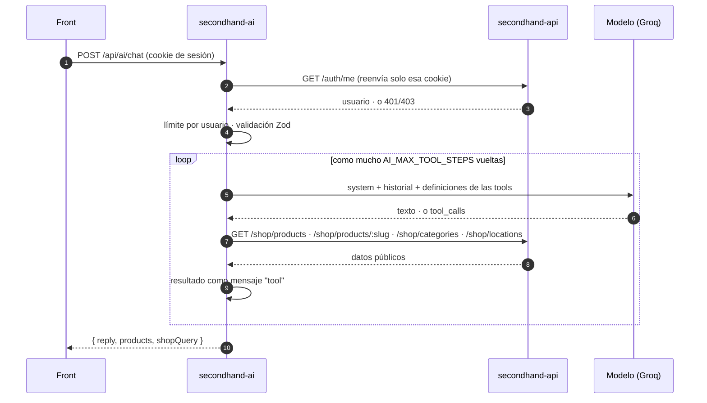

<div align="center">

# 🤖 Revishop · Servicio de IA

**Asistente de compra con herramientas y asistente de anuncios.**
Un microservicio aparte, **sin acceso a la base de datos**: todo lo que sabe de la tienda se lo pide a la API.


[Puesta en marcha](#-puesta-en-marcha) · [Proveedor y modelo](#-proveedor-y-modelo) · [Endpoints](#️-endpoints) · [El agente](#-el-agente) · [Seguridad](#️-seguridad) · [Errores](#-errores) · [Estructura](#-estructura)

</div>

---

## 🚀 Puesta en marcha

> **Requisitos:** Node.js 22.15+ y la **API arrancada** (de ella saca la sesión y los productos). Lo normal es arrancarlo todo junto con `npm run dev` desde la raíz del proyecto.

```bash
npm install
cp .env.example .env    # pon GROQ_API_KEY y AI_MODEL (o AI_PROVIDER=fake para probar sin key)
npm run dev             # http://localhost:3001/api/ai  (node --watch)
```

El front no habla con este puerto: va por el **gateway** (`http://localhost:4000/api/ai`).

> [!IMPORTANT]
> Sin la key o sin `AI_MODEL` el servicio **arranca igual**, avisa en el log y el asistente responde `503` («El asistente está desactivado en este momento»). La tienda funciona igual con la IA desactivada o caída.

### ⚙️ Variables de entorno

Se validan con Zod en `src/config/env.js`. **No hay ninguna URI de base de datos**, y `npm run check` comprueba que el código no importe `mongoose`, `mongodb` ni nada de `secondhand-api`.

| Variable | | Para qué |
|---|:-:|---|
| `PORT` | | Puerto (por defecto `3001`) |
| `CORE_API_URL` | | La API de la tienda, **con** `/api` (por defecto `http://localhost:3000/api`) |
| `CORE_API_TIMEOUT_MS` | | Cuánto se espera a la API antes de dar `503` (por defecto `5000`) |
| `CORS_ORIGIN` | 🏭 | Orígenes del front, para la comprobación de `Origin`. CORS lo pone el gateway |
| `AI_PROVIDER` | | `groq` (por defecto) · `openrouter` · `xai` · `fake` |
| `GROQ_API_KEY` · `OPENROUTER_API_KEY` · `XAI_API_KEY` | 🔑 | Solo la del proveedor elegido. **Nunca** se registra ni se devuelve |
| `AI_MODEL` | 🔑 | El modelo del proveedor. **Tiene que admitir tools** (tool calling) |
| `AI_BASE_URL` | | Opcional: otra URL compatible con la API de OpenAI (un proxy, un servidor local…) |
| `AI_MAX_TOKENS` | | Tope de tokens por respuesta (por defecto `600`) |
| `AI_TIMEOUT_MS` | | Cuánto se espera al proveedor (por defecto `25000`) |
| `AI_MAX_TOOL_STEPS` | | Vueltas modelo → herramientas como máximo (por defecto `4`) |
| `AI_RATE_LIMIT_PER_HOUR` | | Mensajes por usuario y hora, sumando chat y anuncios (por defecto `30`) |

🏭 obligatoria en producción · 🔑 necesaria para que el asistente responda (salvo con `fake`)

---

## 🔀 Proveedor y modelo

Todos los proveedores reales hablan la **API de OpenAI**, así que se usa el mismo SDK (`openai`) y solo cambian la URL y la key. **Cambiar de proveedor o de modelo es cambiar el `.env`**, sin tocar código.

| `AI_PROVIDER` | URL | Notas |
|---|---|---|
| `groq` | `https://api.groq.com/openai/v1` | **Por defecto.** Modelos abiertos y plan gratuito. Key en [console.groq.com/keys](https://console.groq.com/keys). Por ejemplo `AI_MODEL=llama-3.3-70b-versatile` |
| `openrouter` | `https://openrouter.ai/api/v1` | Muchos modelos con una sola key (de pago o `:free`) |
| `xai` | `https://api.x.ai/v1` | Grok directamente (no confundir con Groq) |
| `fake` | — | Respuestas con guion fijo: para probar el flujo y las tarjetas **sin key, sin gastar y sin internet** |

```bash
# Pasar de Groq a OpenRouter
AI_PROVIDER=openrouter
OPENROUTER_API_KEY=...
AI_MODEL=...            # el id del modelo tal como sale en su catálogo, uno que admita tools
```

Para añadir otro proveedor compatible: su nombre en `AI_PROVIDERS` y su URL en `AI_BASE_URLS` (`src/constants/ai.constants.js`), y su key en `src/config/env.js`. Si no es compatible con OpenAI, un `src/llm/<nombre>.provider.js` con la misma función `complete()`.

> [!TIP]
> El SDK tiene `maxRetries: 0`: si el proveedor falla, se avisa al momento en lugar de reintentar mientras el usuario espera (y paga).

---

## 🛣️ Endpoints

Todos bajo `/api/ai` · respuestas `{ success: true, data }` o `{ success: false, message, errors? }`.

| | Método | Ruta | Descripción |
|:-:|---|---|---|
| 🌐 | `GET` | `/api/ai/health` | `{ status, provider, model, enabled }`. No llama al proveedor |
| 🔑 | `POST` | `/api/ai/chat` | Asistente de compra |
| 🔑 | `POST` | `/api/ai/listings/draft` | Asistente de anuncio. **No guarda nada** |

### 💬 `POST /api/ai/chat`

```jsonc
// petición: el historial lo guarda el front (como mucho 20 mensajes de 1000 caracteres; el último, del usuario)
{ "messages": [{ "role": "user", "content": "Busco una bici de montaña en Valencia por menos de 300 €" }] }

// respuesta
{ "success": true, "data": {
  "reply": "He encontrado 2 bicis de montaña en Valencia…",
  "products": [ /* los de la última búsqueda, tal cual los da /api/shop/products */ ],
  "shopQuery": { "search": "bici montaña", "location": ["valencia"], "maxPrice": 300, "status": ["disponible"] }
} }
```

`shopQuery` usa los nombres de los query params de `/shop`, así el front monta el botón «Ver todos en la tienda». Es `null` si no hubo búsqueda con resultados.

### ✍️ `POST /api/ai/listings/draft`

```jsonc
// petición: lo que ya hay en el formulario (excludeSlug al editar, para no compararse consigo mismo)
{ "title": "Bicicleta de montaña 29\"", "categoryId": "665f…", "condition": "bueno", "excludeSlug": "bici-mtb" }

// respuesta
{ "success": true, "data": {
  "description": "Bicicleta de montaña con ruedas de 29 pulgadas en buen estado…",
  "priceRange": { "min": 180, "max": 320, "basedOn": 7, "basis": "similar" },
  "category": { "name": "Bicicletas", "slug": "bicicletas" }
} }
```

- La **descripción** la redacta el modelo (de 2 a 4 frases), y luego se limpia **en código**: se quitan markdown, enlaces, correos y teléfonos, y se recorta a 600 caracteres por una frase entera.
- El **rango de precio no lo decide el modelo**: son los percentiles 25–75 de `basePrice` de productos reales. Primero se buscan los parecidos por título dentro de la categoría (`basis: "similar"`); si hay menos de 3, toda la categoría (`basis: "category"`); y si aun así no hay 3, `priceRange: null`.
- Las dos cosas se piden **en paralelo**.

---

## 🧠 El agente



Un bucle sin frameworks, entero en `src/services/chat.service.js`: el modelo pide herramientas, se ejecutan, se le devuelven los resultados y vuelve a pensar, hasta que contesta con texto. Si agota las vueltas, responde con un mensaje honesto («No he podido completar la búsqueda…») y los productos que hubiera encontrado.

| Herramienta | Qué hace | Endpoint de la API |
|---|---|---|
| `search_products` | Busca con texto, categoría, ubicación, estado, precio y orden. Como mucho **6** productos, **solo disponibles** | `GET /shop/products` |
| `get_product` | Detalle: descripción (recortada a 300 caracteres) y variantes | `GET /shop/products/:slug` (+ `/variants`) |
| `list_categories` | Categorías con su slug y cuántos productos tienen (para no inventarse slugs) | `GET /shop/categories` |
| `list_locations` | Ubicaciones con productos a la venta | `GET /shop/locations` |

Cada herramienta tiene **un esquema Zod** que sirve para dos cosas: validar lo que manda el modelo y generar el JSON Schema que se le enseña (`z.toJSONSchema`). Una sola fuente de verdad.

Si el modelo se equivoca (herramienta que no existe, JSON roto, argumentos no válidos, un 404…), **no se lanza un error**: se le devuelve `{ error }` para que corrija o lo diga. Solo se propagan los fallos del sistema (la API caída → `503`). Como mucho se atienden 4 llamadas por vuelta.

---

## 🛡️ Seguridad

| | Cómo |
|---|---|
| 🗄️ **Sin base de datos** | Ni URI ni Mongoose: un fallo en la IA no puede leer ni tocar la base de datos. Lo vigila `npm run check` |
| 🔑 **Sesión de la API** | `GET /auth/me` reenviando **solo** la cookie `revishop_session`. Así se respeta todo lo que decide la API (token revocado, usuario suspendido…) **sin compartir `JWT_SECRET`** |
| 🔍 **Herramientas de solo lectura** | Solo endpoints públicos de `/shop`, y **sin la cookie del usuario**: aunque alguien engañe al modelo, lo peor que puede pasar es una búsqueda |
| 💉 **Inyección de instrucciones** | El cliente solo puede mandar mensajes `user` y `assistant` (nunca `system` ni `tool`). Los resultados de las herramientas van como mensajes `tool` (datos, no órdenes) y las descripciones de los vendedores se recortan |
| 🃏 **Tarjetas con datos reales** | Los productos de la respuesta salen de la API, no del texto del modelo: no se puede inventar un precio ni un enlace. El front pinta `reply` como **texto**, nunca como HTML |
| 💸 **Gasto controlado** | 30 mensajes por usuario y hora (`429` con `Retry-After`), `max_tokens`, timeout, vueltas limitadas, y se **aborta** la llamada al modelo si el usuario cierra el chat |
| 🧱 **CSRF** | `checkOrigin` como en la API; las cookies son `SameSite=Strict` |
| 📝 **Logs** | Por cada llamada: usuario, modelo, tokens y milisegundos. **Nunca** el contenido de los mensajes ni la key |

> [!NOTE]
> Los contadores del límite viven en memoria: se reinician al reiniciar el servicio. Con varias instancias haría falta un almacén compartido (p. ej. Redis).

---

## 🚨 Errores

Al cliente **nunca** le llega el error crudo del proveedor (puede llevar datos de la cuenta); eso va solo al log.

| Código | Cuándo |
|:-:|---|
| `401` | Sin sesión, o la API dice que ya no vale → «Inicia sesión para usar el asistente» (el front intenta renovar antes) |
| `403` | Usuario suspendido o inactivo (lo dice la API) · `Origin` no permitido |
| `422` | Historial o formulario no válidos, con el detalle por campo |
| `429` | Límite del usuario superado · o el proveedor está saturado |
| `502` | El proveedor ha fallado o no ha devuelto nada útil |
| `503` | Asistente desactivado (sin key, key mala o sin saldo) · la API de la tienda no responde |
| `504` | El proveedor no ha respondido en `AI_TIMEOUT_MS` |

---

## 🧱 Estructura

```
src/
├── clients/coreApi.client.js   la ÚNICA fuente de datos: /auth/me y /shop/* por HTTP
├── config/                     env.js (Zod) · zod.js (mensajes en español)
├── constants/                  ai.constants (proveedores, límites, mensajes) · shop.constants (copia de los de la API)
├── controllers/                ai.controller (aborta si el cliente se va)
├── llm/                        index (complete, providerInfo) · openai.provider · fake.provider · errors
├── middlewares/                session (requireSession) · rateLimit · origin · validate
├── prompts/                    system.prompt (compra) · listing.prompt (anuncio)
├── routes/ai.routes.js         health, chat, listings/draft
├── services/                   chat.service (bucle del agente) · listing.service (descripción + rango)
├── tools/                      search_products · get_product · list_categories · list_locations · summaries
├── utils/                      AppError · errorHandler · response
├── validators/ai.validator.js  esquemas del chat y del anuncio
└── server.js                   trust proxy, helmet, json 32 kB, cookies, rutas y apagado ordenado
```

> [!WARNING]
> `shop.constants.js` es una **copia** de valores de la API (estados de conservación, órdenes…), porque este servicio no importa código de la API. Si allí cambian, hay que cambiarlos aquí; si no, la API responderá `422` y el modelo lo verá como un error.

---

<div align="center">

Hecho con ☕ para **2º DAW** · [README general](../README.md) · [API](../secondhand-api/README.md) · [Gateway](../secondhand-gateway/README.md) · [Frontend](../secondhand-front/README.md)

</div>
