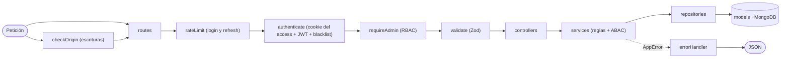
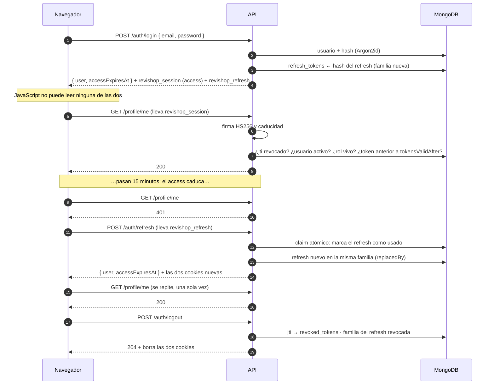
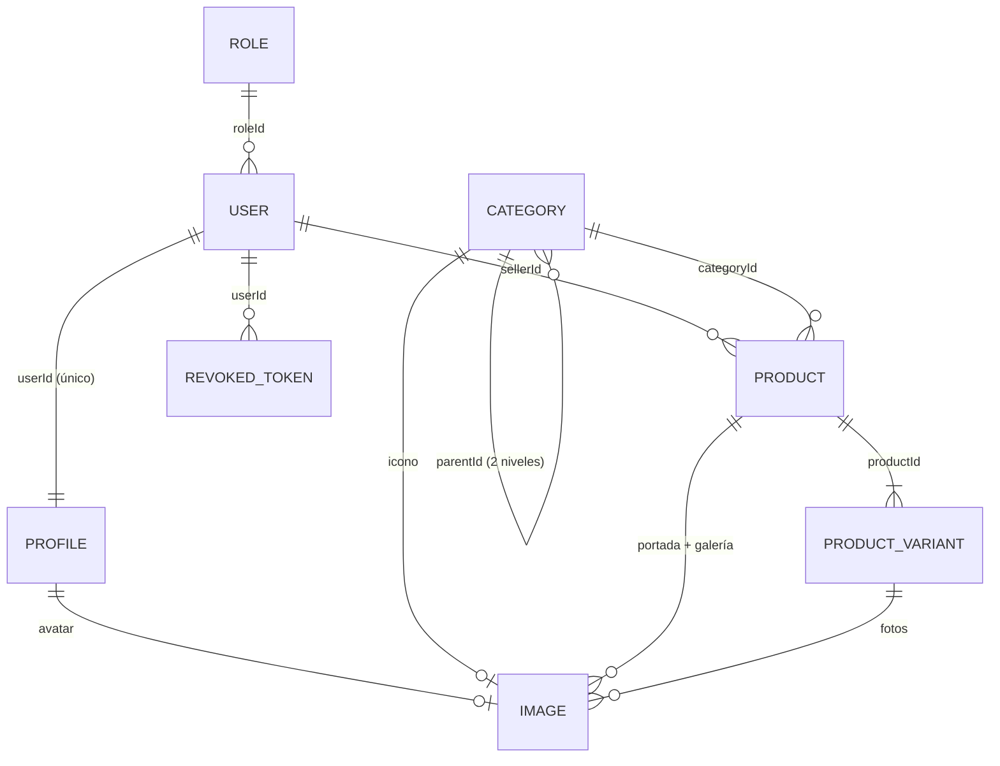

<div align="center">

# 🔌 Revishop · API

**API REST del marketplace de segunda mano Revishop.**
Por capas, con validación Zod, soft delete en cascada, sesión con **access y refresh token** en cookies `httpOnly` y documentación interactiva.


[Puesta en marcha](#-puesta-en-marcha) · [Seed](#-seed) · [Arquitectura](#️-arquitectura) · [Sesión](#-sesión-y-seguridad) · [Endpoints](#️-endpoints) · [Tienda](#️-tienda-home-y-shop) · [Modelo](#️-modelo-de-datos) · [Errores](#-errores)

</div>

---

## 🚀 Puesta en marcha

> **Requisitos:** Node.js 22.15 o superior y MongoDB en local (o una URI de Atlas). En el día a día se arranca todo junto con `npm run dev` desde la raíz del proyecto; el navegador habla con el **gateway** (`http://localhost:4000/api`), que reenvía aquí.

```bash
npm install
cp .env.example .env    # rellena MONGODB_URI, JWT_SECRET y SEED_DEFAULT_PASSWORD
npm run seed            # datos de prueba
npm run dev             # http://localhost:3000/api  (node --watch)
```

| | URL |
|---|---|
| 🔌 API | http://localhost:3000/api |
| 📖 Swagger | http://localhost:3000/api/docs (inicia sesión con *Try it out* en `POST /auth/login`: la cookie se envía sola en el resto de pruebas) |
| 🧪 Ejemplos | [`postman.md`](postman.md) |

### ⚙️ Variables de entorno

Se validan con Zod en un único sitio (`src/config/env.js`): si falta una obligatoria, la API **no arranca** y dice cuál.

| Variable | | Uso |
|---|:-:|---|
| `MONGODB_URI` | ✅ | Conexión, p. ej. `mongodb://localhost:27017/secondhand-db` |
| `JWT_SECRET` | ✅ | Firma de los access tokens: **mínimo 32 caracteres**, aleatoria y fuera del repositorio |
| `JWT_ACCESS_EXPIRES_IN` | | Duración del **access token**: `15m`, `1h`… (por defecto `15m`). Corto a propósito: el front lo renueva solo |
| `REFRESH_TOKEN_TTL_DAYS` | | Días que vale cada **refresh token** (por defecto `7`) |
| `REFRESH_SESSION_MAX_DAYS` | | Tope de una sesión desde el login, aunque se renueve a diario (por defecto `30`) |
| `REFRESH_REUSE_GRACE_SECONDS` | | Margen para que dos pestañas renueven a la vez sin que cuente como robo (por defecto `30`) |
| `PORT` | | Puerto HTTP (por defecto `3000`) |
| `NODE_ENV` | | `development` · `production` (cookies `Secure` y sin logs de error) · `test` |
| `CORS_ORIGIN` | 🏭 | Orígenes del front, separados por comas, para la comprobación de `Origin` (CSRF). **CORS lo pone el gateway**. En desarrollo, si falta, `http://localhost:4200` |

> [!NOTE]
> `JWT_EXPIRES_IN` (de cuando había un solo token de 1 día) **ya no se usa**: si sigue en tu `.env`, la API avisa al arrancar. Quítala o cámbiala por `JWT_ACCESS_EXPIRES_IN`.
| `SEED_DEFAULT_PASSWORD` | 🌱 | Contraseña de todos los usuarios del seed (mínimo 8 caracteres) |

✅ obligatoria · 🏭 obligatoria en producción (en desarrollo tiene valor por defecto) · 🌱 solo para el seed

> [!TIP]
> Genera un `JWT_SECRET` con:
> ```bash
> node -e "console.log(require('crypto').randomBytes(48).toString('hex'))"
> ```

---

## 🌱 Seed

```bash
npm run seed
```

> [!WARNING]
> **Vacía** las colecciones antes de cargar los datos, sincroniza los índices e inserta en orden de dependencias.

| Colección | Datos |
|---|---|
| `roles` | `admin`, `moderator` y `user` (`isSystem: true`) con sus permisos. No hay rol de vendedor: cualquiera compra y vende |
| `users` | 1 admin y 5 usuarios (uno **suspendido**), emails `@revishop.test`, contraseña `SEED_DEFAULT_PASSWORD` con hash Argon2id |
| `profiles` | Uno por usuario: ubicación, bio y avatar |
| `categories` | 9 principales (una en **borrador**) y 4 subcategorías (Móviles, Ordenadores, Chaquetas, Pádel) con atributos de variante |
| `products` | **20**: 14 activos, 3 inactivos y 3 en la papelera |
| `productvariants` | 27: la de por defecto de cada producto y las de los 5 que tienen opciones (talla, color, capacidad, memoria) |
| `images` | Portada y galería de los productos, y el avatar de cada perfil |
| `revoked_tokens` | Vacía: la llena el logout (access tokens revocados) |
| `refresh_tokens` | Vacía: la llenan los logins (una sesión por login y navegador) |

| | Email | Rol |
|:-:|---|---|
| 🛡️ | `admin@revishop.test` | admin |
| 🙋 | `lucia@` · `juan@` · `marta@` · `carlos@revishop.test` | user |
| ⛔ | `pablo@revishop.test` | user, **suspendido** (no puede iniciar sesión ni vender) |

---

## 🏗️ Arquitectura



| Capa | Responsabilidad |
|---|---|
| `routes/` | URL, middlewares, validador y controlador, con su documentación Swagger al lado |
| `middlewares/` | `checkOrigin` (CSRF) · `authenticate` · `optionalAuthenticate` (leen la cookie del access) · `requireAdmin` / `adminOnly` · `loginRateLimit` · `refreshRateLimit` · `validate` (params, query y body) |
| `controllers/` | Funciones `const` con `try/catch` → `next(error)`; pasan el usuario de la sesión (`req.user`) al service |
| `services/` | **Las reglas de negocio**, la propiedad (*¿es suyo?*) y la **integridad referencial** |
| `repositories/` | Lo único que toca Mongo: consultas, `populate` y proyecciones |
| `models/` | Esquemas, relaciones y los plugins `softDelete` y `slug` |
| `constants/` · `utils/` | Valores fijos y funciones sin base de datos: `jwt`, `refreshToken`, `sessionCookie`, `password`, `access`, `slugify`, `url`… |

```
src/
├── config/          env.js (entorno validado) · db.js · swagger.js
├── constants/       auth · category · image · product · role · user
├── middlewares/     auth · admin · origin · rateLimit · validate
├── models/          role · user · profile · category · product · productVariant · image · revokedToken · refreshToken
│   └── plugins/     softDelete.plugin.js · slug.plugin.js
├── repositories/    uno por modelo
├── services/        auth · refreshToken · profile · user · role · category · product · productVariant · shop
├── controllers/     auth · profile · user · role · category · product · productVariant
├── routes/          auth · profile · user (+ /sellers) · role · category · product · productVariant
├── validators/      schemas Zod de entrada (+ common.validator.js)
├── utils/           AppError · errorHandler · response · jwt · refreshToken · sessionCookie · password · access · slugify · url…
├── seed.js
└── server.js
```

---

## 🔐 Sesión y seguridad

La sesión usa **dos tokens**, cada uno en su cookie `httpOnly`:

| | Access token | Refresh token |
|---|---|---|
| Qué es | JWT HS256 (`sub`, `email`, `role`, `jti`, `issuedAtMs`) | 32 bytes aleatorios en base64url, **opaco** (no es un JWT) |
| Dura | **15 min** (`JWT_ACCESS_EXPIRES_IN`) | **7 días** (`REFRESH_TOKEN_TTL_DAYS`), con tope de **30 días** por sesión |
| Dónde se guarda en la API | En ningún sitio (solo su `jti` si se revoca) | En `refresh_tokens`, **solo su hash SHA-256** |
| Para qué | Va en **cada** petición a `/api` | Solo sirve para pedir un access nuevo en `/api/auth/refresh` |
| Si lo roban | Vale como mucho 15 min | Se detecta al reutilizarse y se cierra la sesión entera |



> El front no espera al 401 si puede evitarlo: con `accessExpiresAt` renueva **un poco antes** de que caduque. El 401 → refresh → reintento es la red de seguridad (pestaña dormida, reloj desfasado…).

### 🍪 Las cookies

| Atributo | `revishop_session` (access) | `revishop_refresh` (refresh) |
|---|---|---|
| `HttpOnly` | sí | sí |
| `SameSite` | `Strict` | `Strict` |
| `Path` | `/api` (toda la API) | **`/api/auth`**: no viaja en las peticiones normales, solo en `refresh`, `logout` y `logout-all` |
| `Max-Age` | Lo que le queda al access (15 min) | Lo que le queda al refresh (7 días o el tope de la sesión) |
| `Secure` | Solo en producción | Solo en producción |

**Solo cookies:** los tokens nunca van en el cuerpo de una respuesta, y la API no acepta `Authorization: Bearer`. `HttpOnly` impide que un XSS los lea; `SameSite=Strict` es la **defensa principal contra CSRF**. Si llega un access que ya no vale, la API borra la cookie en el mismo 401.

### 🔄 Rotación y detección de robo

Cada refresh **sirve una sola vez**: al usarlo se marca como usado (de forma atómica) y se crea otro en la misma **familia** (una familia = un login en un navegador).

| Qué llega a `/auth/refresh` | Respuesta |
|---|---|
| Un refresh válido sin usar | **200**: access y refresh nuevos, con el rol actual del usuario |
| Uno que se acaba de usar hace menos de **30 s** (`REFRESH_REUSE_GRACE_SECONDS`) | **409**: dos pestañas renovando a la vez. No borra nada: el navegador ya tiene las cookies nuevas |
| Uno **ya usado** fuera de ese margen | **401** y se **revoca toda la familia**: hay dos copias del token, así que una la tiene otra persona |
| Caducado, revocado, inexistente, o de una cuenta que ya no puede entrar | **401** y borra las dos cookies |
| Más de **300 renovaciones en 15 min** desde la misma IP | **429** con `Retry-After` |

Así, si alguien roba un refresh, en cuanto él o el dueño lo use por segunda vez la sesión se cierra para los dos.

| | Cómo |
|---|---|
| 🔑 **Access** | JWT HS256. El **rol se lee de la base de datos** en cada petición: si se lo cambian, manda el nuevo |
| 🚫 **Logout real** | El `jti` del access va a `revoked_tokens` (un índice **TTL** borra la fila cuando habría caducado) y se revoca la familia del refresh. Es **idempotente**: siempre borra las dos cookies |
| 🌍 **Logout en todas partes** | `POST /auth/logout-all` revoca todos los refresh del usuario y sube `tokensValidAfter`: los access de sus otros navegadores dejan de valer **al momento** (se compara en milisegundos con `issuedAtMs`) |
| 🧹 **Limpieza** | Un índice TTL borra los refresh caducados de `refresh_tokens` |
| 🔒 **Contraseñas** | **Argon2id** (parámetros OWASP), entre 8 y 128 caracteres; las antiguas en bcrypt se pasan a Argon2 al iniciar sesión. Nunca salen en una respuesta |
| 🧯 **Fuerza bruta** | **10 fallos cada 15 min por IP + email** y **50 por IP** → `429` con `Retry-After`. Los logins correctos no cuentan |
| 🕵️ **Sin pistas** | Email inexistente o contraseña mala dan el **mismo** `401`; el login hace el mismo trabajo en los dos casos |
| ⛔ **Cierre de sesiones** | Cambiar la contraseña, desactivar, suspender o borrar a un usuario invalida **todos** sus access (`tokensValidAfter`) y revoca **todos** sus refresh |
| 🛡️ **RBAC** | `requireAdmin` en las rutas de gestión (roles `admin` · `moderator` · `user`) |
| 👤 **ABAC** | Los services comprueban la propiedad (`isOwnerOrAdmin`): un usuario solo toca lo suyo |
| 🧱 **CSRF** | `SameSite=Strict` y, además, `checkOrigin`: un `POST`, `PUT`, `PATCH` o `DELETE` con un `Origin` que no sea el front ni la propia API → **403 "Origen no permitido"**. Sin `Origin` (curl, Postman) pasa: no es un navegador |
| 🌍 **CORS** | Lo pone el **gateway** (puerto 4000), que es al que habla el navegador: solo los orígenes de su `CORS_ORIGIN` y con `credentials: true`. La API confía en él (`trust proxy` en loopback) para la IP real del cliente |
| 🪖 **Cabeceras** | Helmet y logs de acceso con Morgan |

---

## 🛣️ Endpoints

**Leyenda:** 🌐 público (si llega una cookie válida se tiene en cuenta) · 🔑 con sesión · 👤 su dueño o un admin · 🛡️ solo admin

<details open>
<summary><b>🔐 Auth y perfil</b></summary>

<br/>

| | Método | Ruta | Descripción |
|:-:|---|---|---|
| 🌐 | `POST` | `/api/auth/login` | `{ email, password }` → `{ user, accessExpiresAt }` + las dos cookies (401 · 403 · 429) |
| 🌐 | `POST` | `/api/auth/refresh` | Con la cookie del refresh: lo rota y pone un access nuevo → `{ user, accessExpiresAt }` (401 · 409 · 429) |
| 🔑 | `GET` | `/api/auth/me` | El usuario de la sesión, con su rol y su perfil |
| 🌐 | `POST` | `/api/auth/logout` | Revoca el access y la sesión del refresh si valen y **siempre** borra las dos cookies (204, idempotente) |
| 🔑 | `POST` | `/api/auth/logout-all` | Cierra **todas** las sesiones del usuario, en todos sus dispositivos (204) |
| 🔑 | `GET` | `/api/profile/me` | Mi perfil |
| 🔑 | `PATCH` | `/api/profile/me` | Teléfono, ubicación, bio y `avatarUrl` (`null` la quita) |

</details>

<details open>
<summary><b>📦 Productos y variantes</b></summary>

<br/>

| | Método | Ruta | Descripción |
|:-:|---|---|---|
| 🌐 | `GET` | `/api/products/slug/:slug` | Detalle con imágenes y variantes. Uno **inactivo** solo lo ven su dueño y el admin (al resto, 404) |
| 🛡️ | `GET` | `/api/products/actives` · `/inactives` · `/trash` · `/:id` | Para el panel |

> El catálogo público ya no está en `/api/products` (que no tiene `GET /`): es [`/api/shop/products`](#️-tienda-home-y-shop), con filtros, búsqueda y paginación en el servidor.

| 🔑 | `POST` | `/api/products` | Crear (el vendedor es el de la sesión; el admin puede indicar otro) |
| 👤 | `PATCH` | `/api/products/:id` | Edición parcial (solo el admin puede cambiar el vendedor) |
| 👤 | `PATCH` | `/api/products/:id/status` · `/:id/active` | Estado de venta · visibilidad |
| 👤 | `DELETE` | `/api/products/:id` | Soft delete **en cascada** (204) |
| 🛡️ | `PATCH` | `/api/products/:id/restore` | Restaura solo lo que se borró a la vez |
| 🌐 | `GET` | `/api/products/:id/variants` | Las variantes (las de un inactivo, igual que él) |
| 👤 | `POST` | `/api/products/:id/variants` | Nueva variante con los atributos de la categoría |
| 👤 | `PATCH` · `DELETE` | `/api/variants/:id` (+ `/status`, `/active`) | El dueño es el del producto |

</details>

<details>
<summary><b>🏷️ Categorías</b></summary>

<br/>

| | Método | Ruta | Descripción |
|:-:|---|---|---|
| 🌐 | `GET` | `/api/categories` | Publicadas y activas |
| 🛡️ | `GET` | `/actives` · `/inactives` · `/trash` (`?status=`) · `/slug/:slug` · `/:id` | Para el panel |
| 🛡️ | `POST` · `PATCH` · `DELETE` | `/api/categories` · `/:id` · `/:id/active` · `/:id/restore` | CRUD |

**Reglas:** nombre único (también frente a la papelera) · solo se cuelga de una principal · no se borra con productos o subcategorías (`409` con cuántos) · una subcategoría no se restaura si su padre sigue en la papelera · un producto solo va a una categoría **publicada y activa**.

</details>

<details>
<summary><b>🙋 Usuarios, roles y vendedores</b></summary>

<br/>

| | Método | Ruta | Descripción |
|:-:|---|---|---|
| 🛡️ | `GET` | `/api/users` (`?isActive=`) · `/actives` · `/inactives` · `/trash` (`?status=`, `?role=`) · `/slug/:slug` · `/:id` | Listados |
| 🛡️ | `POST` · `PATCH` · `DELETE` | `/api/users` · `/:id` · `/:id/active` · `/:id/restore` | CRUD (el perfil va dentro: teléfono, ubicación, bio y `avatarUrl`) |
| 🛡️ | `GET` | `/api/roles` | Roles asignables (sin CRUD) |
| 🌐 | `GET` | `/api/sellers` | Quién puede vender: activos y no suspendidos, solo campos públicos |

**Reglas:** email único (si es de uno de la papelera, el `409` dice que lo restaures) · el rol tiene que existir · **siempre queda un admin activo** · no se borra un usuario con productos (sí se puede desactivar o suspender).

</details>

---

## 🛍️ Tienda (Home y Shop)

Módulo propio (`shop.routes` → `shop.controller` → `shop.service` → `shop.repository`), separado del CRUD de productos. **Todo es público, de solo lectura y nunca devuelve nada inactivo ni eliminado** (tampoco a su dueño: su vista previa sigue en `/products/slug/:slug`).

| | Método | Ruta | Para |
|:-:|---|---|---|
| 🌐 | `GET` | `/api/shop/categories` | Carrusel del Home: publicadas, con `productsCount` (una principal suma sus subcategorías) |
| 🌐 | `GET` | `/api/shop/sellers` | Carrusel del Home: vendedores con algo a la venta, con avatar y `productsCount` |
| 🌐 | `GET` | `/api/shop/locations` | Carrusel del Home: `{ name, slug, productsCount }` |
| 🌐 | `GET` | `/api/shop/products` | El shop: filtros, búsqueda, orden y paginación → `{ items, pagination, search? }` |
| 🌐 | `GET` | `/api/shop/products/:slug` | Details: el producto con sus fotos |
| 🌐 | `GET` | `/api/shop/products/:slug/variants` | Details: las variantes que se pueden elegir (activas, en orden, con precio, stock y estado) |

### 🔎 Query params de `/api/shop/products`

Todos opcionales; **varios filtros se combinan (Y)** y **cada filtro admite varios valores (O)**, con comas o repitiendo el parámetro:

```
/api/shop/products?category=moviles,ordenadores&condition=nuevo&condition=como_nuevo&maxPrice=500&sort=price-asc&page=2
/api/shop/products?location=valencia&search=bici
/api/shop/products?seller=lucia-martin&status=disponible,reservado
```

| Param | Valores | Filtro en Mongo |
|---|---|---|
| `category` | slugs (incluye subcategorías) | `categoryId: { $in }` |
| `seller` | slugs | `sellerId: { $in }` |
| `location` | slugs (`/shop/locations`) | `locationSlug: { $in }` |
| `condition` · `status` | sus valores válidos | `condition` / `status: { $in }` |
| `minPrice` · `maxPrice` | números ≥ 0 (`min ≤ max`) | `basePrice: { $gte, $lte }` |
| `search` | 2 a 80 caracteres | `$text` y, si no hay resultados, regex sobre `title` |
| `sort` | `recent` · `price-asc` · `price-desc` · `relevance` | siempre con desempate por `_id` |
| `page` · `limit` | `≥ 1` · `1–48` (12 por defecto) | `skip` + `limit`, y `countDocuments` en paralelo |

**Cómo se monta la query (`buildShopFilter`):** cada filtro es una función pequeña que devuelve su trozo, nada si no se pidió o `null` si se pidió y ninguno de sus slugs existe (entonces la respuesta es vacía sin consultar productos). Los slugs se pasan a ids **en paralelo** y en una consulta por filtro (`$in`). Todo llega validado por Zod: un valor no permitido, más de 10 valores, `?category[$gt]=…` o `minPrice > maxPrice` dan **422** por campo.

**Búsqueda en dos pasos:** primero `$text` con el índice de texto en español (palabras completas, sin distinguir tildes; "zapatillas" encuentra "zapatilla") y orden por relevancia. Si no encuentra nada, una **regex escapada** sobre el título que tampoco distingue tildes (`"iph"` → "iPhone", `"pade"` → "pádel"). La respuesta dice cuál se usó: `search: { term, mode: "text" | "partial" }`. Lo que escribe el usuario nunca se interpreta como regex.

### ⚡ Índices de `products`

Regla **ESR** (igualdad → orden → rango). Todas las consultas de la tienda llevan `isActive: true` y `deletedAt: null`, y el orden desempata por `_id` para que la paginación sea estable, así que `_id` va al final: sin él, MongoDB tendría que terminar de ordenar en memoria.

| Índice | Consulta |
|---|---|
| `{ isActive, deletedAt, createdAt: -1, _id: -1 }` | Sin filtros, por fecha (y las listas del panel) |
| `{ isActive, deletedAt, categoryId, createdAt: -1, _id: -1 }` | Por categoría |
| `{ isActive, deletedAt, sellerId, createdAt: -1, _id: -1 }` | Por vendedor |
| `{ isActive, deletedAt, locationSlug, createdAt: -1, _id: -1 }` | Por ubicación |
| `{ isActive, deletedAt, basePrice, _id }` | Orden por precio (en los dos sentidos) y rango de precio |
| Texto `{ title: 3, description: 1 }` en español | Búsqueda (solo puede haber uno por colección) |
| `{ categoryId }` · `{ sellerId }` | Comprobaciones de integridad (¿tiene productos?) |

Comprobado con `explain("executionStats")`: cada forma de consulta usa su índice (`IXSCAN`, nunca `COLLSCAN`), examina exactamente los documentos que devuelve y no ordena en memoria.

> [!NOTE]
> Si tu base se sembró antes de estos índices, vuelve a ejecutar `npm run seed`: sincroniza los índices (borra los antiguos, como el primer índice de texto, y crea los nuevos).

---

## 🗃️ Modelo de datos



| Colección | Claves |
|---|---|
| `roles` | `admin`, `moderator` y `user`, con sus permisos |
| `users` | La **cuenta**: `roleId`, email único, `passwordHash`, estado `pending · verified · suspended` y `tokensValidAfter` |
| `profiles` | El **perfil**, 1 a 1 con su usuario. Sin CRUD propio: nace, se edita, se borra y se restaura con él |
| `categories` | `parentId`, `status` `draft · published` y `attributes` (heredados por las subcategorías que no tienen los suyos) |
| `products` | `sellerId`, `categoryId`, `basePrice` y `status` **calculado** a partir de sus variantes |
| `productvariants` | Opciones, SKU único, precio propio (o el base) y stock |
| `images` | **Polimórfica**: `ownerType` + `ownerId` (`refPath`); al sustituirlas, las anteriores van a la papelera |
| `revoked_tokens` | Blacklist del logout: `jti` único, `userId`, motivo y `expiresAt` con índice **TTL** |

**En todas** (salvo `revoked_tokens`): `isActive`, `deletedAt`, `deletedBy`, `createdAt`, `updatedAt` y `slug` (menos `profiles`).

| Regla | Detalle |
|---|---|
| 🗑️ **Soft delete** | Plugin de Mongoose que oculta lo borrado en todas las consultas. En **cascada** (variantes, imágenes, perfil) y la restauración es **exacta**: solo vuelve lo que se borró a la vez |
| ✍️ **`deletedBy`** | Quién mandó cada cosa a la papelera (también lo que cae en cascada; `null` si fue el seed). Se vacía al restaurar |
| 🔗 **Integridad referencial** | MongoDB no tiene claves foráneas, así que la garantizan **los services**: cada uno vigila su entidad (rol asignable, categoría que acepta productos, vendedor que puede vender…) |
| 🎨 **Variantes** | Todo producto tiene al menos una; la de por defecto nace con él |
| 🖼️ **Fotos sin pérdidas** | Sin transacciones, primero se crean las nuevas y luego se retiran las anteriores; si falla una nueva, se borran las ya creadas |

---

## 🚨 Errores

Todas las respuestas tienen la misma forma:

```jsonc
// ✅ éxito
{ "success": true, "data": { … } }

// ❌ error — `errors` aparece si va ligado a campos
{ "success": false, "message": "Los datos enviados no son válidos",
  "errors": [{ "field": "images.0.url", "message": "Cada imagen debe tener una URL http(s) válida" }] }
```

| Código | Cuándo |
|:-:|---|
| `200` · `201` · `204` | Lectura o edición · creación · borrado |
| `401` | Sin cookie de sesión, o con un token caducado, revocado o no válido (la cookie se borra) · credenciales incorrectas |
| `403` | Sin permiso (no es admin o no es suyo) · cuenta que no puede entrar · escritura desde un origen no permitido |
| `404` | No existe, está en la papelera o es un anuncio inactivo ajeno · ruta inexistente |
| `409` | Choca con otro registro (título, email) o con su estado (borrar una categoría con productos, quitar al último admin) |
| `413` | El cuerpo de la petición supera 100 KB |
| `415` | Formato no soportado: un `charset` que no es UTF-8 o una compresión (`Content-Encoding`) desconocida |
| `422` | Datos no válidos: Zod, reglas del service, Mongoose (`CastError`, `ValidationError`) o JSON mal formado. Los mensajes por defecto de Zod salen **en español** |
| `429` | Demasiados intentos de login (espera lo que diga `Retry-After`) |
| `503` | MongoDB no responde (caído o reiniciándose): tras 5 s de espera, en vez de dejar la petición colgada |
| `500` | Cualquier otro: "Error interno del servidor". Al cliente nunca le llegan detalles; en el log queda siempre la traza, también en producción |

### 🛟 Robustez del proceso

| Situación | Qué hace la API |
|---|---|
| Falta la carpeta `logs/` (está en `.gitignore`) | La crea al arrancar |
| MongoDB se cae y vuelve | Responde 503 mientras tanto, lo anota en el log y se reconecta sola |
| `Ctrl+C` / `SIGTERM` | Deja de aceptar peticiones, termina las que están en curso, cierra MongoDB y sale (como mucho 10 s) |
| Promesa rechazada sin `catch` | La registra y sigue atendiendo |
| Excepción fuera de una petición | La registra y se cierra de forma ordenada (código 1): el proceso ya no es fiable |
| Puerto ocupado | "El puerto … ya está en uso" y sale con código 1 |
| El cliente corta la petición a mitad | No se trata como un fallo del servidor |

---

<div align="center">

**Stack:** Express · Mongoose · Zod · Argon2 · jsonwebtoken · cookie-parser · express-rate-limit · Helmet · Morgan · CORS · Swagger
<sub>bcryptjs solo para pasar a Argon2 las contraseñas antiguas</sub>

[README general](../README.md) · [Frontend](../secondhand-front/README.md)

</div>
