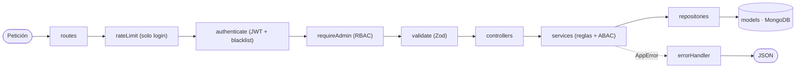
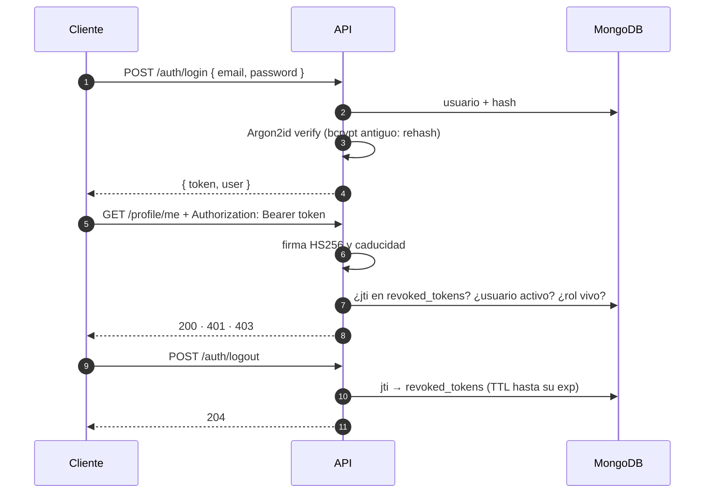
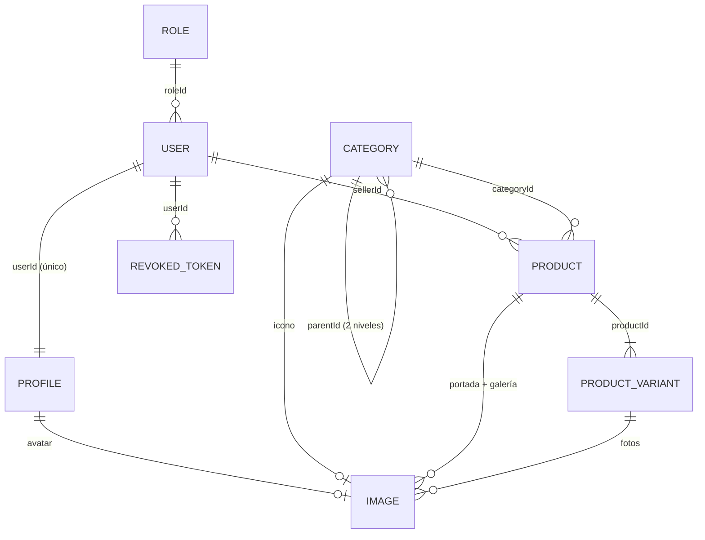

<div align="center">

# 🔌 Revishop · API

**API REST del marketplace de segunda mano Revishop.**
Por capas, con validación Zod, soft delete en cascada, sesión con JWT y documentación interactiva.


[Puesta en marcha](#-puesta-en-marcha) · [Seed](#-seed) · [Arquitectura](#️-arquitectura) · [Sesión](#-sesión-y-seguridad) · [Endpoints](#️-endpoints) · [Modelo](#️-modelo-de-datos) · [Errores](#-errores)

</div>

---

## 🚀 Puesta en marcha

> **Requisitos:** Node.js 18 o superior y MongoDB en local (o una URI de Atlas).

```bash
npm install
cp .env.example .env    # rellena MONGODB_URI, JWT_SECRET y SEED_DEFAULT_PASSWORD
npm run seed            # datos de prueba
npm run dev             # http://localhost:3000/api  (node --watch)
```

| | URL |
|---|---|
| 🔌 API | http://localhost:3000/api |
| 📖 Swagger | http://localhost:3000/api/docs (botón **Authorize** para probar con sesión) |
| 🧪 Ejemplos | [`postman.md`](postman.md) |

### ⚙️ Variables de entorno

Se validan con Zod en un único sitio (`src/config/env.js`): si falta una obligatoria, la API **no arranca** y dice cuál.

| Variable | | Uso |
|---|:-:|---|
| `MONGODB_URI` | ✅ | Conexión, p. ej. `mongodb://localhost:27017/secondhand-db` |
| `JWT_SECRET` | ✅ | Firma de los tokens: **mínimo 32 caracteres**, aleatoria y fuera del repositorio |
| `JWT_EXPIRES_IN` | | Caducidad de los tokens: `15m`, `1h`, `7d`… (por defecto `1d`) |
| `PORT` | | Puerto HTTP (por defecto `3000`) |
| `NODE_ENV` | | `development` · `production` (CORS restringido y sin logs de error) · `test` |
| `CORS_ORIGIN` | 🏭 | Orígenes permitidos en producción, separados por comas |
| `SEED_DEFAULT_PASSWORD` | 🌱 | Contraseña de todos los usuarios del seed (mínimo 8 caracteres) |

✅ obligatoria · 🏭 obligatoria en producción · 🌱 solo para el seed

> [!TIP]
> Genera un `JWT_SECRET` con:
> ```bash
> node -e "console.log(require('crypto').randomBytes(48).toString('hex'))"
> ```

---

## 🌱 Seed

```bash
npm run seed
```

> [!WARNING]
> **Vacía** las colecciones antes de cargar los datos, sincroniza los índices e inserta en orden de dependencias.

| Colección | Datos |
|---|---|
| `roles` | `admin`, `moderator` y `user` (`isSystem: true`) con sus permisos. No hay rol de vendedor: cualquiera compra y vende |
| `users` | 1 admin y 5 usuarios (uno **suspendido**), emails `@revishop.test`, contraseña `SEED_DEFAULT_PASSWORD` con hash Argon2id |
| `profiles` | Uno por usuario: ubicación, bio y avatar |
| `categories` | 9 principales (una en **borrador**) y 4 subcategorías (Móviles, Ordenadores, Chaquetas, Pádel) con atributos de variante |
| `products` | **20**: 14 activos, 3 inactivos y 3 en la papelera |
| `productvariants` | 27: la de por defecto de cada producto y las de los 5 que tienen opciones (talla, color, capacidad, memoria) |
| `images` | Portada y galería de los productos, y el avatar de cada perfil |
| `revoked_tokens` | Vacía: la llena el logout |

| | Email | Rol |
|:-:|---|---|
| 🛡️ | `admin@revishop.test` | admin |
| 🙋 | `lucia@` · `juan@` · `marta@` · `carlos@revishop.test` | user |
| ⛔ | `pablo@revishop.test` | user, **suspendido** (no puede iniciar sesión ni vender) |

---

## 🏗️ Arquitectura



| Capa | Responsabilidad |
|---|---|
| `routes/` | URL, middlewares, validador y controlador, con su documentación Swagger al lado |
| `middlewares/` | `authenticate` · `optionalAuthenticate` · `requireAdmin` / `adminOnly` · `loginRateLimit` · `validate` (params, query y body) |
| `controllers/` | Funciones `const` con `try/catch` → `next(error)`; pasan el usuario de la sesión (`req.user`) al service |
| `services/` | **Las reglas de negocio**, la propiedad (*¿es suyo?*) y la **integridad referencial** |
| `repositories/` | Lo único que toca Mongo: consultas, `populate` y proyecciones |
| `models/` | Esquemas, relaciones y los plugins `softDelete` y `slug` |
| `constants/` · `utils/` | Valores fijos y funciones puras sin base de datos: `jwt`, `password`, `access`, `slugify`, `url`… |

```
src/
├── config/          env.js (entorno validado) · db.js · swagger.js
├── constants/       auth · category · image · product · role · user
├── middlewares/     auth · admin · rateLimit · validate
├── models/          role · user · profile · category · product · productVariant · image · revokedToken
│   └── plugins/     softDelete.plugin.js · slug.plugin.js
├── repositories/    uno por modelo
├── services/        auth · profile · user · role · category · product · productVariant
├── controllers/     auth · profile · user · role · category · product · productVariant
├── routes/          auth · profile · user (+ /sellers) · role · category · product · productVariant
├── validators/      schemas Zod de entrada (+ common.validator.js)
├── utils/           AppError · errorHandler · response · jwt · password · access · slugify · url · email…
├── seed.js
└── server.js
```

---

## 🔐 Sesión y seguridad



| | Cómo |
|---|---|
| 🔑 **Token** | JWT HS256 con `sub`, `email`, `role` y `jti`. El **rol se lee de la base de datos** en cada petición: si se lo cambian, manda el nuevo |
| 🚫 **Logout real** | El `jti` va a `revoked_tokens`; un índice **TTL** borra la fila cuando el token habría caducado |
| 🔒 **Contraseñas** | **Argon2id** (parámetros OWASP), entre 8 y 128 caracteres; las antiguas en bcrypt se pasan a Argon2 al iniciar sesión. Nunca salen en una respuesta |
| 🧯 **Fuerza bruta** | **10 fallos cada 15 min por IP + email** y **50 por IP** → `429` con `Retry-After`. Los logins correctos no cuentan |
| 🕵️ **Sin pistas** | Email inexistente o contraseña mala dan el **mismo** `401`; el login hace el mismo trabajo en los dos casos |
| ⛔ **Cierre de sesiones** | Cambiar la contraseña, desactivar, suspender o borrar a un usuario invalida **todos** sus tokens (`tokensValidAfter`) |
| 🛡️ **RBAC** | `requireAdmin` en las rutas de gestión (roles `admin` · `moderator` · `user`) |
| 👤 **ABAC** | Los services comprueban la propiedad (`isOwnerOrAdmin`): un usuario solo toca lo suyo |
| 🪖 **Cabeceras** | Helmet, CORS restringido en producción y logs de acceso con Morgan |

---

## 🛣️ Endpoints

**Leyenda:** 🌐 público (un token válido se tiene en cuenta) · 🔑 con sesión · 👤 su dueño o un admin · 🛡️ solo admin

<details open>
<summary><b>🔐 Auth y perfil</b></summary>

<br/>

| | Método | Ruta | Descripción |
|:-:|---|---|---|
| 🌐 | `POST` | `/api/auth/login` | `{ email, password }` → `{ token, user }` (401 · 403 · 429) |
| 🔑 | `GET` | `/api/auth/me` | El usuario de la sesión, con su rol y su perfil |
| 🔑 | `POST` | `/api/auth/logout` | Revoca el token (204) |
| 🔑 | `GET` | `/api/profile/me` | Mi perfil |
| 🔑 | `PATCH` | `/api/profile/me` | Teléfono, ubicación, bio y `avatarUrl` (`null` la quita) |

</details>

<details open>
<summary><b>📦 Productos y variantes</b></summary>

<br/>

| | Método | Ruta | Descripción |
|:-:|---|---|---|
| 🌐 | `GET` | `/api/products` | Catálogo: **solo activos**, con categoría, vendedor y portada |
| 🌐 | `GET` | `/api/products/slug/:slug` | Detalle con imágenes y variantes. Uno **inactivo** solo lo ven su dueño y el admin (al resto, 404) |
| 🛡️ | `GET` | `/api/products/actives` · `/inactives` · `/trash` · `/:id` | Para el panel |
| 🔑 | `POST` | `/api/products` | Crear (el vendedor es el de la sesión; el admin puede indicar otro) |
| 👤 | `PATCH` | `/api/products/:id` | Edición parcial (solo el admin puede cambiar el vendedor) |
| 👤 | `PATCH` | `/api/products/:id/status` · `/:id/active` | Estado de venta · visibilidad |
| 👤 | `DELETE` | `/api/products/:id` | Soft delete **en cascada** (204) |
| 🛡️ | `PATCH` | `/api/products/:id/restore` | Restaura solo lo que se borró a la vez |
| 🌐 | `GET` | `/api/products/:id/variants` | Las variantes (las de un inactivo, igual que él) |
| 👤 | `POST` | `/api/products/:id/variants` | Nueva variante con los atributos de la categoría |
| 👤 | `PATCH` · `DELETE` | `/api/variants/:id` (+ `/status`, `/active`) | El dueño es el del producto |

</details>

<details>
<summary><b>🏷️ Categorías</b></summary>

<br/>

| | Método | Ruta | Descripción |
|:-:|---|---|---|
| 🌐 | `GET` | `/api/categories` | Publicadas y activas |
| 🛡️ | `GET` | `/actives` · `/inactives` · `/trash` (`?status=`) · `/slug/:slug` · `/:id` | Para el panel |
| 🛡️ | `POST` · `PATCH` · `DELETE` | `/api/categories` · `/:id` · `/:id/active` · `/:id/restore` | CRUD |

**Reglas:** nombre único (también frente a la papelera) · solo se cuelga de una principal · no se borra con productos o subcategorías (`409` con cuántos) · una subcategoría no se restaura si su padre sigue en la papelera · un producto solo va a una categoría **publicada y activa**.

</details>

<details>
<summary><b>🙋 Usuarios, roles y vendedores</b></summary>

<br/>

| | Método | Ruta | Descripción |
|:-:|---|---|---|
| 🛡️ | `GET` | `/api/users` (`?isActive=`) · `/actives` · `/inactives` · `/trash` (`?status=`, `?role=`) · `/slug/:slug` · `/:id` | Listados |
| 🛡️ | `POST` · `PATCH` · `DELETE` | `/api/users` · `/:id` · `/:id/active` · `/:id/restore` | CRUD (el perfil va dentro: teléfono, ubicación, bio y `avatarUrl`) |
| 🛡️ | `GET` | `/api/roles` | Roles asignables (sin CRUD) |
| 🌐 | `GET` | `/api/sellers` | Quién puede vender: activos y no suspendidos, solo campos públicos |

**Reglas:** email único (si es de uno de la papelera, el `409` dice que lo restaures) · el rol tiene que existir · **siempre queda un admin activo** · no se borra un usuario con productos (sí se puede desactivar o suspender).

</details>

---

## 🗃️ Modelo de datos



| Colección | Claves |
|---|---|
| `roles` | `admin`, `moderator` y `user`, con sus permisos |
| `users` | La **cuenta**: `roleId`, email único, `passwordHash`, estado `pending · verified · suspended` y `tokensValidAfter` |
| `profiles` | El **perfil**, 1 a 1 con su usuario. Sin CRUD propio: nace, se edita, se borra y se restaura con él |
| `categories` | `parentId`, `status` `draft · published` y `attributes` (heredados por las subcategorías que no tienen los suyos) |
| `products` | `sellerId`, `categoryId`, `basePrice` y `status` **calculado** a partir de sus variantes |
| `productvariants` | Opciones, SKU único, precio propio (o el base) y stock |
| `images` | **Polimórfica**: `ownerType` + `ownerId` (`refPath`); al sustituirlas, las anteriores van a la papelera |
| `revoked_tokens` | Blacklist del logout: `jti` único, `userId`, motivo y `expiresAt` con índice **TTL** |

**En todas** (salvo `revoked_tokens`): `isActive`, `deletedAt`, `deletedBy`, `createdAt`, `updatedAt` y `slug` (menos `profiles`).

| Regla | Detalle |
|---|---|
| 🗑️ **Soft delete** | Plugin de Mongoose que oculta lo borrado en todas las consultas. En **cascada** (variantes, imágenes, perfil) y la restauración es **exacta**: solo vuelve lo que se borró a la vez |
| ✍️ **`deletedBy`** | Quién mandó cada cosa a la papelera (también lo que cae en cascada; `null` si fue el seed). Se vacía al restaurar |
| 🔗 **Integridad referencial** | MongoDB no tiene claves foráneas, así que la garantizan **los services**: cada uno vigila su entidad (rol asignable, categoría que acepta productos, vendedor que puede vender…) |
| 🎨 **Variantes** | Todo producto tiene al menos una; la de por defecto nace con él |
| 🖼️ **Fotos sin pérdidas** | Sin transacciones, primero se crean las nuevas y luego se retiran las anteriores; si falla una nueva, se borran las ya creadas |

---

## 🚨 Errores

Todas las respuestas tienen la misma forma:

```jsonc
// ✅ éxito
{ "success": true, "data": { … } }

// ❌ error — `errors` aparece si va ligado a campos
{ "success": false, "message": "Los datos enviados no son válidos",
  "errors": [{ "field": "images.0.url", "message": "Cada imagen debe tener una URL http(s) válida" }] }
```

| Código | Cuándo |
|:-:|---|
| `200` · `201` · `204` | Lectura o edición · creación · borrado |
| `401` | Sin sesión, token caducado, revocado o no válido · credenciales incorrectas |
| `403` | Sin permiso (no es admin o no es suyo) · cuenta que no puede entrar |
| `404` | No existe, está en la papelera o es un anuncio inactivo ajeno · ruta inexistente |
| `409` | Choca con otro registro (título, email) o con su estado (borrar una categoría con productos, quitar al último admin) |
| `422` | Datos no válidos: Zod, reglas del service, Mongoose (`CastError`, `ValidationError`) o JSON mal formado |
| `429` | Demasiados intentos de login (espera lo que diga `Retry-After`) |
| `500` | Cualquier otro: "Error interno del servidor" |

---

<div align="center">

**Stack:** Express · Mongoose · Zod · Argon2 · jsonwebtoken · express-rate-limit · Helmet · Morgan · CORS · Swagger
<sub>bcryptjs solo para pasar a Argon2 las contraseñas antiguas</sub>

[README general](../README.md) · [Frontend](../secondhand-front/README.md)

</div>
