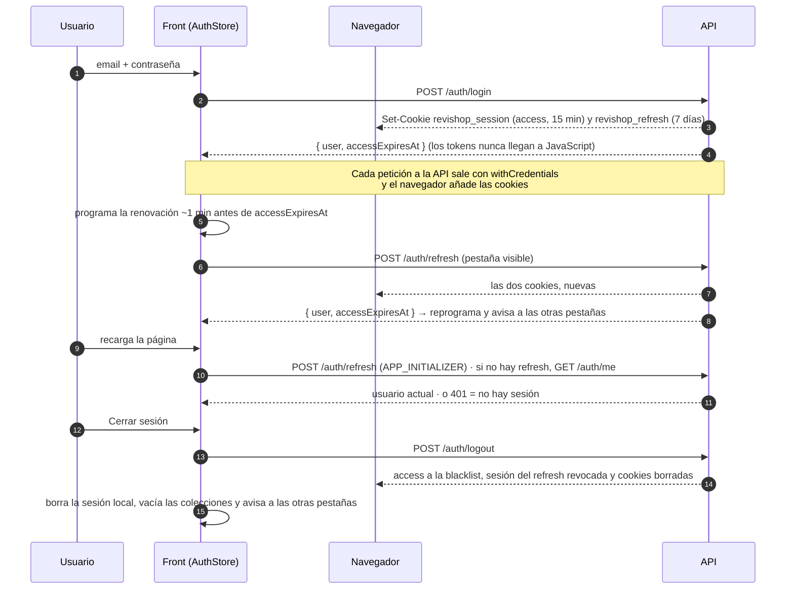

<div align="center">


# Revishop · Frontend

**Cada objeto merece una segunda vida.**
SPA del marketplace de segunda mano Revishop: Home y tienda públicas, publicación de anuncios, Mi perfil y un panel de administración completo.


[Puesta en marcha](#-puesta-en-marcha) · [Sesión y permisos](#-sesión-y-permisos) · [Pantallas](#️-pantallas) · [API](#-api-consumida) · [Estructura](#-estructura) · [Diseño](#-sistema-de-diseño) · [Decisiones](#-decisiones-técnicas)

</div>

---

## ✨ Qué hace

<table>
<tr>
<td width="50%" valign="top">

### 🛍️ Tienda
- **Home** con carruseles de categorías, vendedores y ubicaciones que abren la tienda filtrada.
- **Shop** con búsqueda (debounce), filtros, orden y paginación **en el servidor**, guardados en la URL.
- Ficha por **slug** con galería, variantes y la *escala de segunda vida*.
- Publicar, editar y retirar **tus** anuncios.
- **Mi perfil**: foto, teléfono, ubicación y bio.

</td>
<td width="50%" valign="top">

### 🛡️ Panel de administración
- Resumen con datos reales del inventario.
- CRUD de **productos** (con variantes), **categorías** (en árbol) y **usuarios** (con avatar).
- Pestañas Activos · Inactivos · Papelera, con cambios **optimistas**.
- Solo para el rol `admin`.

</td>
</tr>
</table>

Todas las pantallas cubren los estados de **carga** (skeleton con la forma real), **vacío**, **sin resultados**, **error con Reintentar** y **no encontrado**.

---

## 🚀 Puesta en marcha

> **Requisitos:** Node.js **18.19+, 20.11+ o 22** (con Node 24 funciona, pero el CLI avisa) · npm 10+ · MongoDB en local para la API.

```bash
# 1 · API (en otra terminal)
cd ../secondhand-api
npm install
npm run seed     # 6 usuarios, categorías y 20 productos (borra los datos de prueba)
npm run dev      # http://localhost:3000/api

# 2 · Front
cd ../secondhand-front
npm install
npm start        # http://localhost:4200
```

> [!IMPORTANT]
> La API necesita un `.env` con `JWT_SECRET` (y `SEED_DEFAULT_PASSWORD` para el seed). Mira [`secondhand-api/README.md`](../secondhand-api/README.md).

### 👥 Usuarios de prueba

Todos usan la contraseña de **`SEED_DEFAULT_PASSWORD`** del `.env` de la API.

| | Email | Rol | Qué puede hacer |
|:-:|---|---|---|
| 🛡️ | `admin@revishop.test` | admin | Todo, panel incluido |
| 🙋 | `lucia@revishop.test` | user | Comprar, publicar y gestionar lo suyo |
| 🙋 | `juan@revishop.test` · `marta@revishop.test` · `carlos@revishop.test` | user | Igual que Lucía |
| ⛔ | `pablo@revishop.test` | user, **suspendido** | No puede iniciar sesión (403) |

**Iniciar sesión:** botón de la barra superior → `/login`. El admin llega a `/admin` y el resto a la tienda. **Cerrar sesión** está en el menú de tu foto.

### 📦 Build

```bash
npm run build                               # producción → dist/secondhand-front
npx ng build --configuration development    # desarrollo
```

---

## 🔐 Sesión y permisos



| Pieza | Dónde | Qué hace |
|---|---|---|
| **`AuthStore`** | `core/auth/auth.store.ts` | Signals `user`, `restoring`, `isAuthenticated`, `role`, `isAdmin`, `hasRole()` e `isOwnerOrAdmin()` (la misma regla que la API). `restore()`, `login()`, `refresh()`, `logout()`, `logoutAll()` y `onSessionEnd()`. Programa la **renovación proactiva**. **No guarda ningún token** |
| **`AuthService`** | `core/auth/auth.service.ts` | Solo HTTP: `login`, `refresh`, `me`, `logout` y `logoutAll` |
| **`AuthChannel`** | `core/auth/auth-channel.ts` | `BroadcastChannel('revishop-auth')`: avisa a las otras pestañas de `login`, `logout` y `refreshed` |
| **`authInterceptor`** | `core/auth/auth.interceptor.ts` | Pone `withCredentials` (para que viajen las cookies) **solo** en las peticiones a la API propia (`isOwnApiUrl`), y las marca con `SENT_WITH_SESSION` si salen con la sesión abierta |
| **`refreshInterceptor`** | `core/auth/refresh.interceptor.ts` | `401` de una petición `SENT_WITH_SESSION` (que no sea de `/auth/`) → renueva la sesión y **reintenta una vez** (`REFRESH_RETRIED`). Si no se puede, deja pasar el 401 original |
| **`errorInterceptor`** | `core/interceptors/` | El `401` que llega hasta él (no se pudo renovar) → cierra la sesión, avisa **una vez** («Tu sesión ha caducado») y lleva a `/login?returnUrl=…`. `403`, `429`, `502` y `504` → mensaje del servidor |
| **Guards** (`canMatch`) | `core/auth/*.guard.ts` | Deciden qué rutas se pueden abrir (tabla de abajo) |

### 🔄 Renovación automática del access

El access dura **15 minutos**; el usuario no debe notarlo. Hay tres caminos, del más normal al de rescate:

| Cuándo | Qué hace el front |
|---|---|
| ⏰ **Antes de que caduque** | Con el `accessExpiresAt` del login o del refresh, `AuthStore` programa un `setTimeout` para renovar **un minuto antes** (o a ¾ de su vida si dura menos de 4 min). Solo con la pestaña **visible**: si está oculta, renueva al volver (`visibilitychange`) |
| 🧯 **Si aun así llega un 401** | El `refreshInterceptor` renueva y repite la petición. Si caen cinco 401 a la vez, se hace **una sola** renovación y las cinco esperan su resultado (**single-flight**) |
| 🔁 **Al recargar la página** | `restore()` intenta primero `POST /auth/refresh` (así arranca con un access recién hecho) y, si no hay refresh, `GET /auth/me` |

**Orden de los interceptores** (`app.config.ts`): `[authInterceptor, loadingInterceptor, errorInterceptor, refreshInterceptor]`. El de refresh va **el último**, el más cerca de la red: las respuestas recorren la lista al revés, así que ve el 401 antes que el `errorInterceptor` y lo arregla sin que salte el aviso. El timeout (`REQUEST_TIMEOUT_MS`) se aplica a cada intento por separado.

**Varias pestañas:** las cookies son del navegador, así que todas las pestañas comparten sesión. Por `BroadcastChannel`:

- **`refreshed`**: otra pestaña ha renovado → esta solo reprograma su temporizador (no renueva otra vez).
- **`logout`**: otra pestaña ha cerrado sesión → esta la cierra también.
- **`login`**: otra pestaña ha iniciado sesión → esta la recupera.

Si dos pestañas renuevan a la vez, la segunda recibe un **409** de la API; el front lo trata como «ya está renovada» y repite la petición con las cookies nuevas.

**Cerrar sesión en todos los dispositivos:** en **Mi perfil → Seguridad** (`POST /auth/logout-all`). Al **desactivar** o **suspender** a un usuario, el panel pide confirmación y avisa de que se cierran sus sesiones.

| Guard | Rutas | Si no se cumple |
|---|---|---|
| `guestGuard` | `/login` | Con sesión → `/admin` (admin) o `/` |
| `authGuard` | `/profile` · `/products/new` · `/products/:slug/edit` | → `/login?returnUrl=…` y vuelve después |
| `adminGuard` | `/admin/**` | Sin sesión → login · sin permiso → `/forbidden` |

> [!NOTE]
> Los guards y los botones ocultos son **comodidad**, no seguridad: la API comprueba cada permiso otra vez.

### 🍪 Por qué cookies y no `localStorage`

Los dos tokens viven en cookies que pone la API (`HttpOnly`, `SameSite=Strict`): `revishop_session` (el access, `Path=/api`) y `revishop_refresh` (`Path=/api/auth`, así que solo viaja al renovar o cerrar sesión). El front **nunca los ve**: `document.cookie` no los muestra y no hay nada en `localStorage` ni en `sessionStorage`. Así, un script malicioso en la página no puede copiar un token y usarlo desde otro sitio.

| | Consecuencia en el front |
|---|---|
| No se pueden leer las cookies | `restore()` no sabe si hay sesión: **siempre** pregunta (refresh y, si no, `/auth/me`). Sin sesión, ese `401` es silencioso (el navegador lo anota en la consola, pero la app no avisa) |
| No se sabe cuándo caduca el access | Por eso la API devuelve `accessExpiresAt` (no es secreto): el temporizador se programa con él |
| Front y gateway en orígenes distintos en desarrollo (`:4200` → `:4000`) | Las peticiones necesitan `withCredentials`; el gateway solo acepta el origen de su `CORS_ORIGIN` |
| JavaScript no puede borrar las cookies | Las borra la API: en el logout (siempre) y en cualquier `401` por un token que ya no vale |
| Versión anterior | Al arrancar se borra el `revishop.token` que guardaba `localStorage` |

> [!TIP]
> Si sirves el front desde otro origen (p. ej. `ng serve --port 4300`), añádelo a `CORS_ORIGIN` en el `.env` del **gateway** (CORS) y en el de la **API** (comprobación de `Origin`); si no, se bloquearán las peticiones.

**Lo tuyo y lo de los demás:** "Editar" y "Retirar" solo aparecen en tus anuncios (o en todos si eres admin), el select **Vendedor** solo lo ve el admin (el resto publica a su nombre) y un anuncio **inactivo** solo lo ven su vendedor y el admin.

---

## 🗺️ Pantallas

**Leyenda:** 🌐 público · 🔑 con sesión · 👤 su dueño o un admin · 🛡️ solo admin · 🚪 solo sin sesión

### 🛍️ Tienda

| Ruta | | Pantalla |
|---|:-:|---|
| `/` | 🌐 | **Home**: carruseles de categorías, vendedores y ubicaciones (cada tarjeta abre el shop filtrado) y lo último publicado |
| `/shop` | 🌐 | **Shop**: búsqueda, filtros con varios valores, rango de precio, orden y paginación; todo en la URL (`?category=moviles,ordenadores&sort=price-asc&page=2`) |
| `/shop/:slug` | 🌐 | **Ficha de la tienda**: producto y sus variantes activas, enlaces al shop por vendedor, categoría y ubicación; *Editar* solo a su dueño o un admin |
| `/products/:slug` | 🌐 | Ficha clásica (galería y variantes, con *Editar / Eliminar* en lo tuyo); a ella llevan Publicar y Editar |
| `/login` | 🚪 | Iniciar sesión, con los errores de la API (credenciales, cuenta bloqueada, demasiados intentos) |
| `/profile` | 🔑 | **Mi perfil**: foto con vista previa, teléfono, ubicación y bio (`PATCH` solo con lo cambiado) |
| `/products/new` | 🔑 | Publicar un anuncio |
| `/products/:slug/edit` | 👤 | Editar (`PATCH` solo con los campos cambiados) |
| `/forbidden` | 🔑 | Acceso denegado |
| `**` | 🌐 | 404 real; un slug inexistente muestra "Producto no encontrado" |

### 🛡️ Panel (`/admin`)

| Ruta | Pantalla |
|---|---|
| `/admin` | Resumen: inventario con barra proporcional, estado de venta, reparto por categoría y últimos productos |
| `/admin/products` · `/inactive` · `/trash` | Productos: interruptor de visibilidad y estado de venta **optimistas**, editor de variantes, papelera restaurable |
| `/admin/categories` · `/inactive` · `/trash` | Categorías en árbol, con borrador y atributos heredados |
| `/admin/users` · `/inactive` · `/trash` | Usuarios con foto, rol, estado y **Avatar (URL)** en el formulario |
| `…/new` · `…/:slug/edit` | Crear y editar cada entidad |

Mensajes, Reservas, Valoraciones, Pagos y Envíos aparecen en el menú como **Próximamente** (`PLATFORM_MODULES` en `features/admin/admin-nav.config.ts`): sin rutas ni datos todavía.

---

## 🔌 API consumida

Base: `environment.apiUrl` · respuestas `{ success: true, data }` o `{ success: false, message, errors? }`.

| Recurso | Endpoints | Uso |
|---|---|---|
| 🔐 **Auth** | `POST /auth/login` · `POST /auth/refresh` · `GET /auth/me` · `POST /auth/logout` · `POST /auth/logout-all` | Sesión y renovación |
| 🤖 **IA** | `POST /ai/chat` · `POST /ai/listings/draft` | Asistente de compra y de anuncio (`AssistantService`); el gateway lo manda al servicio de IA |
| 👤 **Perfil** | `GET` · `PATCH /profile/me` | Mi perfil |
| 🛍️ **Tienda** | `GET /shop/categories` · `/shop/sellers` · `/shop/locations` · `/shop/products` · `/shop/products/:slug` · `/:slug/variants` | Home, shop y ficha (`ShopService`) |
| 📦 **Productos** | `GET /products/slug/:slug` | Ficha de gestión |
| | `GET /products/actives` · `/inactives` · `/trash` | Pestañas del panel |
| | `POST /products` · `PATCH /:id` · `/:id/status` · `/:id/active` · `/:id/restore` · `DELETE /:id` | Escrituras |
| 🎨 **Variantes** | `/products/:id/variants` · `/variants/:id` (+ `/status`, `/active`) | Editor de variantes |
| 🏷️ **Categorías** | `/categories` (CRUD completo) | Filtros, formulario y panel |
| 🙋 **Usuarios** | `/users` (CRUD completo) · `GET /roles` · `GET /sellers` | Panel y select de vendedor |

---

## 🧱 Estructura

```
src/app/
├── core/                    Infraestructura transversal (no conoce productos)
│   ├── auth/                AuthStore, AuthService, AuthChannel, authInterceptor, refreshInterceptor y guards
│   ├── config/              HttpContextTokens y constantes
│   ├── interceptors/        errorInterceptor (401/403/429, timeout, alertas) y loadingInterceptor
│   ├── models/              ApiResponse<T>, ApiError
│   ├── services/            ApiService (Observable → Promise), EntityApiService, LoadingService, AlertService
│   └── store/               EntityStore y RemoteCollection (base de todos los stores)
├── shared/
│   ├── components/          navbar, user-menu, loader, skeleton, empty-state, error-state, page-not-found,
│   │                        search-box, filter-panel, pagination, carousel…
│   ├── ui/                  icon, avatar, badge, level-meter, stat-card, toggle-switch
│   └── utils/               validadores, mensajes de error, diff para PATCH, pipes
├── layouts/                 main-layout (tienda) y admin-layout (sidebar + drawer móvil)
├── features/
│   ├── auth/                login y acceso denegado
│   ├── profile/             Mi perfil
│   ├── catalog/             categorías y vendedores compartidos (CatalogStore)
│   ├── shop/                Home, shop y ficha: ShopService, ShopStore, shop-query (URL ⇄ filtros), cards
│   ├── products/            modelo, servicios, ProductsStore, componentes y páginas
│   ├── users/               modelo, servicios y UsersStore
│   ├── assistant/           widget del chat, tarjeta de producto, AssistantService y AssistantStore
│   └── admin/               panel: dashboard, products, categories, users
├── app.routes.ts            /admin (adminGuard) + tienda + 404
└── app.config.ts            router, interceptores, APP_INITIALIZER (restaura la sesión), locale es-ES
```

<details>
<summary><b>➕ Añadir una feature nueva</b></summary>

<br/>

Cada módulo (reservas, pagos, favoritos…) va en `features/<nombre>/` con sus `models/`, `services/` (sobre `ApiService` o `EntityApiService`), `store/` (sobre `EntityStore`), `components/`, `pages/` y un `<nombre>.routes.ts`. Los interceptores, las alertas, el loader, la sesión y los estados de error ya funcionan para cualquier petición.

- **Rutas en la tienda:** añádelas sueltas en `app.routes.ts` (`...MIS_RUTAS`), **no** como `{ path: '', loadChildren }` delante del catálogo: un grupo `''` lazy se queda con la URL vacía aunque ninguno de sus hijos coincida y la portada sale en blanco. Las páginas siguen siendo lazy con `loadComponent`.
- **Si guarda datos del usuario:** el `EntityStore` ya se vacía al cerrar sesión; un store propio puede usar `authStore.onSessionEnd()`.
- **En el panel:** crea su ruta en `features/admin/admin.routes.ts` y mueve su entrada de `PLATFORM_MODULES` a `ADMIN_NAV`.

</details>

---

## 🎨 Sistema de diseño

| | |
|---|---|
| **Tipografía** | Poppins (400–700) con `preconnect` y `display=swap` |
| **Tokens** | Colores en `src/styles.scss` (`:root`) como canales RGB; Tailwind los usa como `primary-*`, `accent`, `ink`, `line`, `canvas`, `surface`. **Cambiar de paleta = cambiar el bloque `:root`** |
| **Escala de segunda vida** | La condición en 5 tramos (Nuevo = 5 … Mejorable = 1) en la tarjeta, la ficha y el formulario |
| **Estados de venta** | 🟢 disponible · 🟠 reservado · ⚫ vendido. Todos los pares texto/fondo cumplen **WCAG AA** (≥ 4,54:1) |
| **Movimiento** | View Transitions de la tarjeta a la ficha; se desactivan con `prefers-reduced-motion` |
| **Responsive** | Sin scroll horizontal desde **375 px**; el panel usa un drawer accesible en móvil |

<details>
<summary><b>🎨 Paletas intercambiables</b></summary>

<br/>

| Token | A · Azul Confianza (activa) | B · Marino + Cian | C · Índigo + Turquesa |
| --- | --- | --- | --- |
| `--color-primary-600` | `37 99 235` (#2563EB) | `29 78 216` (#1D4ED8) | `79 70 229` (#4F46E5) |
| `--color-primary-900` | `30 58 138` (#1E3A8A) | `11 31 58` (#0B1F3A) | `49 46 129` (#312E81) |
| `--color-primary-700` | `29 78 216` | `18 56 107` (#12386B) | `67 56 202` |
| `--color-accent` | `245 158 11` (#F59E0B) | `6 182 212` (#06B6D4) | `20 184 166` (#14B8A6) |
| `--color-canvas` | `248 250 252` (#F8FAFC) | `244 247 251` (#F4F7FB) | `250 250 249` (stone-50) |
| `--color-ink-muted` | `71 85 105` | `71 85 105` | `87 83 78` (stone-600) |

Al cambiar de paleta, revisa también `primary-50/100/200/400/500` y el contraste del texto sobre `accent`. Con B y C el acento es claro, así que el texto del botón "Publicar" debe seguir siendo `ink`.

</details>

---

## 🧠 Decisiones técnicas

<details>
<summary><b>🗄️ Datos y estado</b></summary>

<br/>

- **Capa asíncrona sin RxJS:** `ApiService` convierte el `Observable` de `HttpClient` en `Promise` (el único `firstValueFrom` de la app). Services y stores usan `async/await`; RxJS solo queda en los interceptores.
- **Store genérico (`EntityStore`):** colecciones (activos, inactivos, papelera), caché de detalle y escrituras optimistas. Cada entidad hereda y solo añade lo suyo; `afterWrite` refresca lo que depende de ella. Los signals son privados y se exponen con `asReadonly()` y `computed()`.
- **Tienda aparte del CRUD:** Home, shop y ficha usan `/api/shop` (`ShopService` + `ShopStore`) y el panel sus propias colecciones, así un usuario nunca pide endpoints de admin.
- **La URL manda en el shop:** `filtersFromParams` / `paramsFromFilters` (`features/shop/models/shop-query.ts`) traducen query params ⇄ filtros; cambiar un filtro navega, y la página carga cuando cambian los params. Recargar, compartir el enlace o volver atrás deja la tienda igual.
- **Peticiones cancelables:** `ShopStore.load()` aborta la anterior con un `AbortController` (`ApiService` acepta `signal`); el `AbortError` no se muestra ni llega al `ErrorHandler`. La búsqueda espera 300 ms sin teclear y al menos 2 caracteres.
- **`CatalogStore`:** categorías y vendedores se cargan una vez y los comparten el formulario, los filtros y las etiquetas. Ninguna categoría está escrita en el código.
- **Slug en las URLs, `_id` en las escrituras:** las rutas son legibles, pero `PATCH` y `DELETE` usan el `_id`. Tras editar se navega al slug de la respuesta, porque cambia con el título.

</details>

<details>
<summary><b>🚨 Errores y carga</b></summary>

<br/>

- **`errorInterceptor`:** timeout (`requestTimeoutMs`), valida la forma `{ success, data }` y lo normaliza todo a `ApiError` con mensajes en español.
  - Las cargas (GET) muestran el error **en la pantalla** con *Reintentar*, nunca en un modal.
  - Las escrituras muestran un modal (SweetAlert2), salvo 400/409/422 al guardar, que el formulario pinta **junto a cada campo**.
  - `401` con sesión → primero el `refreshInterceptor` intenta renovar y repetir; si no puede, cierra la sesión y va al login. Las peticiones de la propia sesión (`login`, `refresh`, `me`, `logout`) lo evitan con `SKIP_AUTH_REDIRECT`.
  - `413`, `415` y `503` tienen su propio mensaje (cuerpo demasiado grande, formato no soportado, base de datos caída).
- **Errores fuera de la API** (`core/errors/`):
  - `GlobalErrorHandler`: un error de JavaScript sin capturar se registra y se avisa con la opción de recargar (como mucho un aviso cada 10 s). Los `ApiError` no se repiten: ya los mostró el interceptor.
  - `handleNavigationError` (`withNavigationErrorHandler`): si una página no se puede descargar (sin conexión o versión nueva publicada), recarga **una vez** directamente en la página a la que ibas; si vuelve a fallar, avisa y deja elegir entre recargar o seguir en la tienda.
  - `main.ts`: si la app no llega a arrancar, en vez de una página en blanco muestra un mensaje con un botón Recargar.
- **Loader global** con retardo de 180 ms para que no parpadee; las pantallas con skeleton lo omiten (`SKIP_GLOBAL_LOADER`).
- **Spinner bloqueante** (ngx-spinner) solo para lo que el usuario espera activamente (guardar, borrar, restaurar), marcado con `BLOCKING_REQUEST`.

</details>

<details>
<summary><b>📦 Productos</b></summary>

<br/>

- **Variantes:** todo producto tiene al menos una. En la ficha, si hay varias, un `radiogroup` cambia precio y disponibilidad; la vendida sale tachada. La tarjeta muestra el mínimo con "desde".
- **Estado de venta:** se cambia desde el panel (`PATCH /products/:id/status`); con varias variantes el selector sale deshabilitado (la API da 422).
- **Imágenes:** hasta 5 por producto, con texto alternativo obligatorio; la primera es la portada y se reordenan con botones accesibles por teclado.
- **Precio:** la API acepta `≥ 0`, el front exige `> 0` (`PRICE_MIN_EXCLUSIVE`).
- **`products/new` va antes que `products/:slug`:** un producto titulado "New" tendría slug `new` y su ficha no sería accesible (caso límite conocido).

</details>

<details>
<summary><b>🤖 Asistente IA</b></summary>

<br/>

Todo va a `environment.apiUrl` como el resto (`/ai/...`): el **gateway** decide que es para el servicio de IA. El front no conoce ningún puerto más ni ninguna key.

- **Asistente de compra** (`features/assistant/`): botón flotante en la tienda (`main-layout`) que abre un panel (a pantalla completa en móvil). Sin sesión invita a iniciarla.
  - El **historial vive en el `AssistantStore`** (no se guarda en el navegador); se mandan los **últimos 10 mensajes**, de 1000 caracteres como mucho. Se vacía al cerrar sesión (`onSessionEnd`).
  - La respuesta del modelo se pinta como **texto** (interpolación, nunca `innerHTML`). Las **tarjetas** salen de `products`, que son datos de la API, y «Ver todos en la tienda» abre `/shop` con los filtros de `shopQuery`.
  - Un mensaje nuevo, «Nueva conversación» o cerrar sesión **abortan** la petición en curso (`AbortController`).
- **Asistente de anuncio** (formulario de publicar y editar): «Sugerir descripción» pide `/ai/listings/draft` con el título, la categoría y el estado. Rellena el textarea **sin guardar**; si ya había texto, no lo pisa: enseña la sugerencia y deja elegir entre sustituirlo o descartarla. También muestra «Productos parecidos se venden entre X € y Y €» si hay rango.
- **Peticiones de IA:** timeout propio (`aiRequestTimeoutMs`, 35 s; el resto usa `requestTimeoutMs`, 10 s), sin loader global y sin modal: el error se pinta **junto a donde se pidió**.

</details>

<details>
<summary><b>⚡ Rendimiento y UX</b></summary>

<br/>

- Todo **standalone** y **`OnPush`**; rutas lazy con precarga, galería en `@defer`, SweetAlert2 bajo demanda y `NgOptimizedImage` con hueco reservado.
- **View Transitions:** se omite la inicial y se capturan los rechazos (con la pestaña oculta el navegador aborta la transición y, sin ese `catch`, la vista se quedaba en blanco).
- **Sin parpadeo de sesión:** mientras se restaura, el menú de usuario muestra un círculo gris en lugar de "Iniciar sesión".
- **Accesibilidad:** labels, `aria-*`, foco al primer error, `aria-live` en los avisos, menús con Escape y clic fuera.

</details>

---

## ⚙️ Variables de entorno

Angular no lee `.env`: la configuración vive en `src/environments/`.

| Fichero | Cuándo se usa | `apiUrl` |
| --- | --- | --- |
| `environment.ts` | `npm run build` (producción) | `/api` (mismo dominio, detrás de un proxy) |
| `environment.development.ts` | `npm start` y `ng build --configuration development` | `http://localhost:4000/api` (el gateway) |

Ambos exponen `production` (logs técnicos solo en desarrollo), `apiUrl` (cámbialo si el gateway va en otro host o puerto), `requestTimeoutMs` (10 000 ms; pasado ese tiempo se muestra "El servidor está tardando demasiado…") y `aiRequestTimeoutMs` (35 000 ms, para el asistente).

---

<div align="center">

Hecho con ☕ y Angular para **2º DAW** · [README general](../README.md) · [API](../secondhand-api/README.md) · [IA](../secondhand-ai/README.md) · [Gateway](../secondhand-gateway/README.md)

</div>
