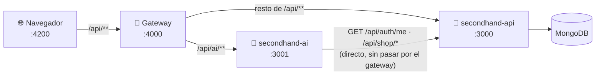

<div align="center">

# 🚪 Revishop · API Gateway

**La única puerta de entrada del navegador.**
Reparte `/api/ai` al servicio de IA y el resto de `/api` a la API de la tienda, con CORS en un solo sitio.


[Puesta en marcha](#-puesta-en-marcha) · [Rutas](#️-rutas) · [Cómo reenvía](#-cómo-reenvía) · [Errores](#-errores) · [Decisiones](#-decisiones)

</div>

---

## 🚀 Puesta en marcha

> **Requisitos:** Node.js **22.15+ o 24+** (lo exige `http-proxy-middleware` 4). Lo normal es arrancarlo todo junto con `npm run dev` desde la raíz del proyecto.

```bash
npm install
cp .env.example .env    # los valores por defecto ya sirven en desarrollo
npm run dev             # http://localhost:4000  (node --watch)
```

| | URL |
|---|---|
| 🚪 Entrada del front | http://localhost:4000/api |
| ❤️ Salud del gateway | http://localhost:4000/health |
| 📖 Swagger de la API | http://localhost:4000/api/docs |

### ⚙️ Variables de entorno

Se validan con Zod en `src/config/env.js`: si una no vale, el gateway **no arranca** y dice cuál.

| Variable | | Para qué |
|---|:-:|---|
| `PORT` | | Puerto del gateway (por defecto `4000`) |
| `API_URL` | | Dónde está la API, **sin `/api`**: la ruta se reenvía tal cual (por defecto `http://localhost:3000`) |
| `AI_URL` | | Dónde está el servicio de IA (por defecto `http://localhost:3001`) |
| `CORS_ORIGIN` | 🏭 | Orígenes del front, separados por comas. **CORS vive solo aquí**. En desarrollo, si falta, `http://localhost:4200` |
| `API_PROXY_TIMEOUT_MS` | | Cuánto se espera a la API antes de dar `504` (por defecto `30000`) |
| `AI_PROXY_TIMEOUT_MS` | | Lo mismo para la IA (por defecto `45000`: una respuesta con herramientas encadena varias llamadas al modelo) |
| `NODE_ENV` | | `development` · `production` · `test` |

🏭 obligatoria en producción

---

## 🛣️ Rutas



| Ruta | Va a | Notas |
|---|---|---|
| `GET /health` | El propio gateway | Dice que está vivo y adónde reparte. No pregunta a los servicios (la IA tiene el suyo en `/api/ai/health`) |
| `/api/ai` y `/api/ai/**` | Servicio de IA | Se comprueba **antes** que `/api` porque es más concreta |
| `/api` y `/api/**` | API de la tienda | Todo lo demás, Swagger incluido |
| Cualquier otra | — | `404` con `{ success: false, message }` |

---

## 🔁 Cómo reenvía

| | Qué hace | Por qué |
|---|---|---|
| 🧭 **Ruta intacta** | `app.use(proxy)` con un `pathFilter`, no `app.use("/api", proxy)` | Express quitaría el prefijo y la API recibiría `/products` en vez de `/api/products` |
| 🎯 **Filtro por función** | `isAiPath` / `isApiPath` en `src/proxy.js` | Con el texto `"/api"` también entraría `/apix` |
| 📦 **Sin leer el body** | Delante no hay `express.json()` | Si el gateway leyera el cuerpo, el servicio lo recibiría vacío. Solo reenvía bytes |
| 🏷️ **Host conservado** | Sin `changeOrigin` | La API compara el `Origin` con su propio origen, que para el navegador es el del gateway |
| 🕵️ **IP real** | Borra los `X-Forwarded-*`, `Forwarded` y `X-Real-IP` del cliente y pone los suyos (la IP de la conexión, el protocolo y el Host) | Si no, cualquiera podría inventarse una IP para saltarse el límite de intentos de login. La API y la IA solo se fían de ellos si vienen de un proxy local (`trust proxy` en loopback) |
| 🍪 **Cookies** | Pasan tal cual, en los dos sentidos | Las dos cookies de sesión (`Path=/api` y `/api/auth`) siguen valiendo porque la ruta no cambia |
| 🌍 **CORS** | `cors({ origin: CORS_ORIGIN, credentials: true })` y las preflight `OPTIONS` se contestan aquí | Si también lo pusieran la API o la IA, la cabecera saldría dos veces y el navegador rechazaría la respuesta. Si un servicio trae su propio `Vary`, se le añade `Origin` en vez de pisarlo |

---

## 🚨 Errores

Si un servicio no responde, el gateway contesta con el **formato de siempre** (`{ success: false, message }`), así que el front lo trata como cualquier otro error. **El otro servicio sigue funcionando**: con la IA caída, la tienda va igual.

| Qué pasa | Código | Mensaje (IA · API) |
|---|:-:|---|
| El servicio no está arrancado o no se llega a él | `502` | «El asistente no está disponible ahora mismo…» · «La tienda no responde ahora mismo…» |
| No responde dentro de su `*_PROXY_TIMEOUT_MS` | `504` | «El asistente ha tardado demasiado en responder…» · «La tienda ha tardado demasiado en responder…» |
| Ruta que no es `/api` ni `/health` | `404` | `Ruta no encontrada: GET /x` |

Cada fallo deja una línea en el log, sin datos del usuario:

```
[gateway] POST /api/ai/chat → ia: no está arrancado (502)
```

> [!NOTE]
> El plugin de errores que trae `http-proxy-middleware` responde en texto plano: se quita (`ejectPlugins: true`) y se vuelven a poner solo los que se usan (`debugProxyErrorsPlugin` y `proxyEventsPlugin`).

---

## 🧭 Decisiones

| Decisión | Por qué |
|---|---|
| **Gateway en Node** y no en nginx | Mismo lenguaje que el resto, se arranca con `npm run dev` y los errores salen en el formato de la app. En un despliegue con HTTPS, nginx (o Nginx Proxy Manager) iría **delante** para el certificado, y este gateway seguiría repartiendo |
| **La IA habla con la API directamente** | Para comprobar la sesión y leer productos no hace falta dar la vuelta por el gateway: es tráfico interno |
| **Sin lógica de negocio** | Ni autenticación ni validación: eso lo deciden la API y la IA. El gateway solo reparte, pone CORS y protege las cabeceras de IP |
| **Un timeout por servicio** | La IA tarda más por naturaleza; con uno solo, o la tienda esperaría demasiado o el asistente se cortaría |
| **Apagado ordenado** | Con `SIGINT`/`SIGTERM` deja de aceptar conexiones y termina las que hay (máximo 10 s) |

```
src/
├── config/env.js    variables validadas con Zod
├── proxy.js         serviceProxy(), isAiPath, isApiPath, cabeceras X-Forwarded-*
└── server.js        helmet, CORS, morgan, /health, los dos proxies, 404 y apagado
```

---

<div align="center">

Hecho con ☕ para **2º DAW** · [README general](../README.md) · [API](../secondhand-api/README.md) · [IA](../secondhand-ai/README.md) · [Frontend](../secondhand-front/README.md)

</div>
